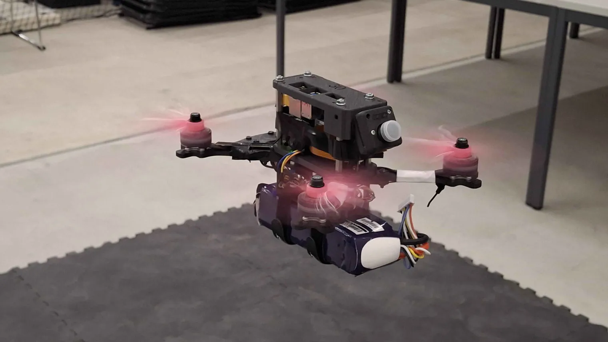
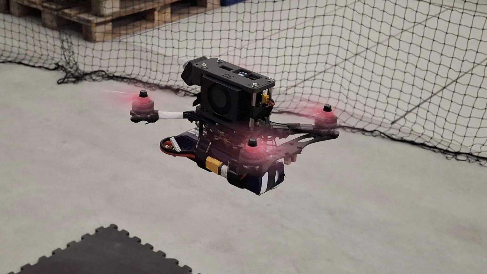
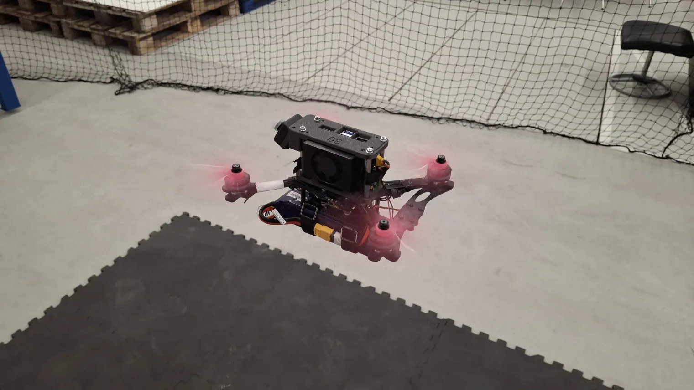
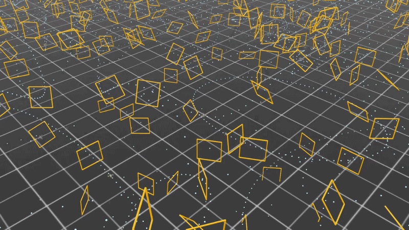
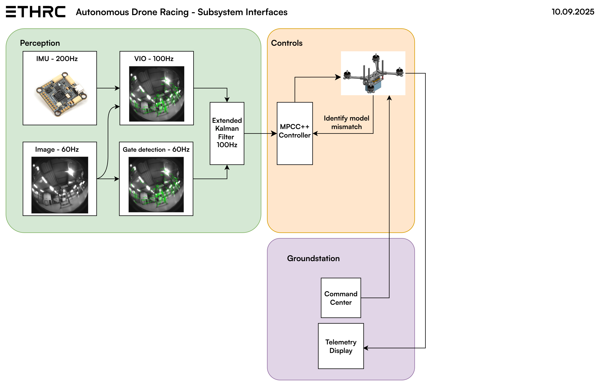

<p align="center">
  <picture>
    <source media="(prefers-color-scheme: dark)" srcset="docs/docs/images/ETHRC-Aeronautics-Logo-Dark.svg">
    <source media="(prefers-color-scheme: light)" srcset="docs/docs/images/ETHRC-Aeronautics-Logo-Light.svg">
    
  </picture>
</p>

<p align="center">
  <b>Pushing the boundaries of Autonomous Drone Racing with ROS 2, PX4, and Cutting-edge Perception.</b>
</p>

<p align="center">
  
  
  
  
</p>

---

## 🚀 The Mission

Welcome to the **ETHRC Drone Racing** project. We are building the next generation of autonomous racing drones capable of navigating complex, high-speed environments with surgical precision. This repository provides a complete, containerized development environment - from high-fidelity simulation to real-world hardware deployment.



---

## 🛠 Project Pillars

| **Perception** | **Control** | **Simulation** |
| :--- | :--- | :--- |
| **State Estimation:** VIO (OpenVINS) + EKF for robust localization. | **High-Speed Tracking:** MPC and RL-based controllers for agile flight. | **Digital Twin:** Gazebo Harmonic for realistic physics and sensor noise. |
| **Object Detection:** Real-time gate and ArUco marker tracking. | **Planning:** Minimal-time trajectory generation through race gates. | **SITL:** PX4 Software-In-The-Loop for autopilot parity. |

---

## 📸 Real-World Hardware & Lab

We don't just simulate; we fly. Our hardware stack is designed for extreme performance and modularity.

<p align="center">
  
  <!--  -->
</p>

<p align="center">
  

  <i><b>Autonomous RL Training Simulation</b>: Drones learning optimal racing lines in IsaacLab.</i>
</p>

---

## ⚡ Quick Start

Get your environment up and running in minutes.

### 1. Clone & Initialize
```bash
git clone --recurse-submodules git@github.com:ETHRoboticsClub/ETHRC-Drone-Racing.git
cd ETHRC-Drone-Racing
```

### 2. Launch Environment
We use Docker to ensure "it works on everyone's machine."
```bash
# Prepare host volumes
sudo ./scripts/prepare_colcon_volumes.sh

# Start the development container
xhost +local:root
docker compose up dev -d
docker compose exec dev bash
```

### 3. Build & Fly
Inside the container:
```bash
# Build the workspace
colcon build --symlink-install --cmake-args -DCMAKE_BUILD_TYPE=RelWithDebInfo
source install/setup.bash

# Launch Simulation & Controller
ros2 launch drone_control drone_controller.launch.py
```

---

## 🏗 System Architecture

Our system is composed of several high-performance subsystems working in harmony. The perception pipeline feeds high-frequency state updates to the MPC controller, ensuring agile and precise flight.



---

## 🤝 Join the Race

Are you passionate about robotics, computer vision, or control theory? We are always looking for motivated engineers to join the ETHRC Aeronautics division.

- 📖 **Documentation:** [http://localhost:8000](http://localhost:8000) (if running locally via `docker compose up docs -d`)
- 📝 **Guidelines (with Coding Agents):** Check out `aeronautics-utility/agents/AGENT.md` for our coding standards.
- 💬 **Get Involved:** Reach out to the team on Discord or Open an Issue!

---

<p align="center">
  Proudly developed by the <b>ETH Robotics Club - Aeronautics Division</b>
</p>
