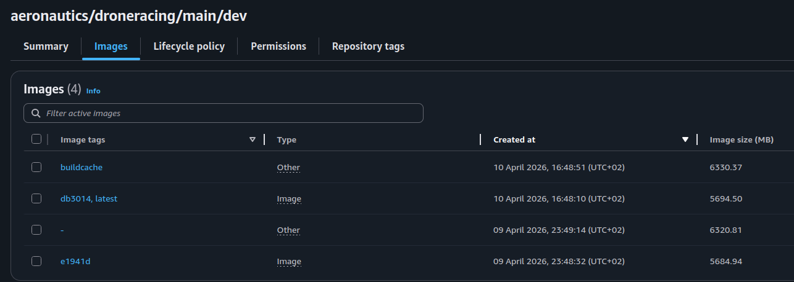

# Dockerfile Notes

## Important

AWS ECR is just a place to dump docker images to. We build Dockerfiles once and then just reference the binary image without having to ever rebuild. It does not have any functionality besides that and it does NOT store Dockerfiles so it is our responsibility to ensure we know which Dockerfile built which image in ECR.

## Structure

The following table maps ECR images to their source Dockerfiles for easier tracing:

| ECR Image | Source Dockerfile |
|-----------|-------------------|
| aeronautics/droneracing:shared-perception-controls-deps-latest | untracked/Dockerfile.base |

**Note:** If you create new Dockerfiles and push images to ECR, please update this table to maintain traceability. 

## Console side of AWS ECR

To demystify AWS ECR, this is what the dev target in the main branch looks like in the console. There are currently two images, each tagged with the commit sha, and the latest tag on the newest image. 'buildcache' speed up future builds.

