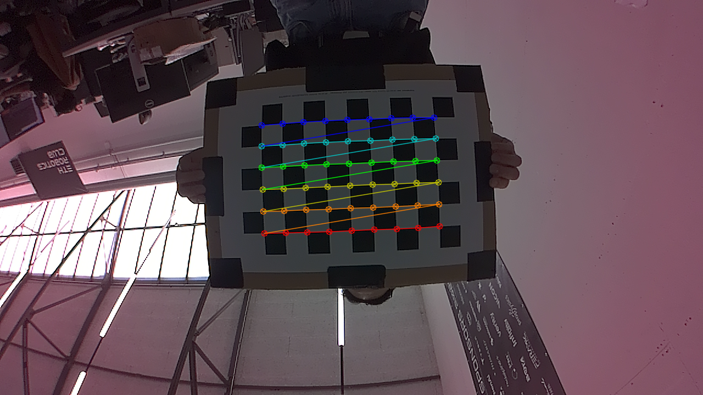
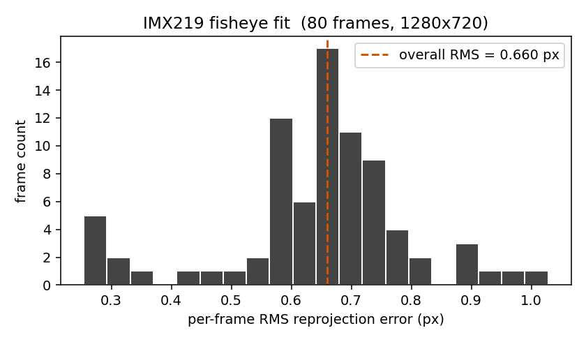

# IMX219 Intrinsics Calibration

**Page Owner:** [Mahbod Tajdini](https://github.com/mahbodtajdini)

Calibration of the IMX219 wide-angle CSI camera mounted on the racing drone (`zephyrus`, Jetson Orin NX), at the standard racing capture mode of **1280×720 @ 60 fps**.

!!! abstract "TL;DR"
    The Kannala-Brandt fisheye fit converged with **0.66 px reprojection RMS** over 80 frames of a 9×6 inner-corner checkerboard. A radtan/plumb_bob fit is also produced for compatibility with the [TII drone-racing-dataset](https://github.com/tii-racing/drone-racing-dataset/blob/main/camera_calibration/calib_a-trackRATM.json) reference schema. Lens HFOV measured at ~131° (diagonal ~150°) — wide-angle confirmed.

The full report (method, hardware, target, recording procedure, results, diagnostics, end-to-end commands) is rendered as a self-contained PDF:

> **[Download imx219_calibration.pdf](assets/imx219_calibration.pdf)** &mdash; 12 pages, 1.1 MB

## Headline numbers

| Parameter | Value | Note |
| --- | --- | --- |
| `fx`, `fy` | `559.382`, `559.454` | Square pixels (Δ < 0.1 px) |
| `cx`, `cy` | `637.689`, `352.823` | ~2-7 px from image centre (normal sensor-mount tolerance) |
| `k1…k4` | `0.0670`, `-0.0285`, `-0.0182`, `0.0587` | Equidistant model |
| HFOV | ~131° | `2·atan(W/2 / fx)` |
| Diagonal FOV | ~150° | Equidistant formulation `θ = r/f` |
| RMS (fisheye) | **0.6604 px** | Pinhole-equi (Kannala-Brandt) |
| RMS (radtan)  | 0.6526 px | 5-coeff plumb_bob |
| Frames used | 80 / 80 | 100 % detection rate |

## Why fisheye, not radtan

The 5-coefficient plumb_bob model loses fidelity past ~120° HFOV because radial distortion stops being well-approximated by an even polynomial in *r*. The Kannala-Brandt **equidistant** model parameterises distortion in *θ* (the angle from the optical axis) and stays accurate well past 180°.

For drone racing, gates and ArUco markers frequently appear at the image periphery during turns — exactly where the two models diverge. The OpenVINS configurations bundled in this repo already use `equidistant` for fisheye sensors (`rs_t265`, `uzhfpv_indoor`), so the choice is consistent with downstream conventions.

## Why OpenCV instead of Kalibr

[Kalibr](https://github.com/ethz-asl/kalibr) is the canonical tool when joint camera↔IMU calibration (`T_cam_imu`, time offsets) is needed. For pure intrinsics on a single sensor, OpenCV's `cv2.fisheye.calibrate` produces the same Kannala-Brandt parameters with a small script, no Docker image, and no ROS 1 dependency. The TII reference numbers cited in the calibration issue were themselves produced by `cv2.calibrateCamera`. Kalibr remains the right tool for the IMU-fusion stage.

## Diagnostics

### Sample detection

{ width=520 }

9×6 inner corners overlaid on a representative frame. The board is held by white margins; the camera is mounted upside-down on the drone (the room ceiling is at the bottom of the image). Image orientation is irrelevant to the intrinsics fit but worth flagging for downstream consumers.

### Per-frame reprojection error

{ width=520 }

The distribution is unimodal around the overall RMS with a small tail of outliers near 1.0 px. No frames were excluded from the fit; the spread is consistent with handheld waving at ~1 board-width per second.

## Reproducing the calibration

Full reproduction commands and the 9-pose recording routine are in the PDF. The condensed version:

```bash title="On zephyrus (the drone)"
ssh aero@zephyrus
cd /home/aero/proj/ETHRC-Drone-Racing
git checkout feature/imx219-calibration && git pull --ff-only
source install/setup.bash

# Optional but strongly recommended: live preview in a second terminal
ros2 run web_video_server web_video_server --ros-args -p port:=8080
# Then on the laptop, open in a browser:
#   http://<zephyrus-ip>:8080/stream?topic=/cam0/image_raw&type=mjpeg

# Record a 60-120 s waving session, hitting the 9 poses listed in the PDF
./scripts/calibration/record_bag.sh

# Process the bag on zephyrus (avoids transferring the GB-scale bag)
./scripts/calibration/calibrate_imx219.py \
  --bag bags/imx219_calib_<TIMESTAMP> \
  --square-size-mm 34.0
```

```bash title="On the laptop"
ZEPH=aero@zephyrus:proj/ETHRC-Drone-Racing/camera_calibration
scp "$ZEPH"/imx219_720p_60fps\* camera_calibration/
```

!!! tip "The physical board"
    **Dimetri currently holds the printed and mounted A3 checkerboard** used for this calibration. Re-use it; the measured 34 mm square size is specific to that print. If you re-print via `scripts/calibration/generate_checkerboard.py`, *measure the new print with a ruler* before recording — printers commonly scale by 1-3 %.

## Files in the repository

| Path | Purpose |
| --- | --- |
| `camera_calibration/imx219_720p_60fps_rms066px.json` | TII-style intrinsics (`mtx` + `dist`) plus an explicit fisheye block |
| `camera_calibration/imx219_720p_60fps_rms066px_kalibr.yaml` | OpenVINS-compatible Kalibr-style YAML |
| `camera_calibration/checkerboard_9x6_35mm_a3.pdf` | Printable target |
| `camera_calibration/sample_detection.png` | Corner-detection overlay |
| `camera_calibration/reprojection_error_hist.png` | Per-frame RMS distribution |
| `src/perception/imx219_argus_camera/config/imx219_720p_60fps_rms066px_kalibr.yaml` | Same YAML, alongside the camera ROS package |
| `src/perception/imx219_argus_camera/config/camera_params.yaml` | Placeholder values replaced with calibrated equidistant model |
| `scripts/calibration/generate_checkerboard.py` | Re-renders the target PDF (uv inline deps) |
| `scripts/calibration/record_bag.sh` | Drives `ros2 bag record` on zephyrus |
| `scripts/calibration/calibrate_imx219.py` | Bag → intrinsics; output filenames carry the achieved RMS |

## Known follow-ups

- **Image orientation.** The mounted camera is rotated 180°. This does not affect intrinsics. The live `argus_camera_node` pipeline applies `flip_method: 2` by default so downstream consumers receive upright frames.
- **Edge coverage.** The current bag stayed mostly central — radtan and fisheye fit equivalently. A re-record with the board pushed harder into the four image corners (and rotated ±45° there) would tighten the fisheye-vs-radtan separation.
- **No IMU coupling.** This calibration is intrinsics-only. The OpenVINS pipeline additionally needs `T_cam_imu` and time offsets, which require a Kalibr camera-IMU run.
