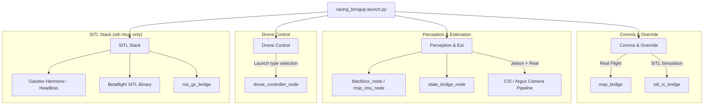

# Racing Bringup Launch File Reference

**Page Owner:** [Leads of the Aeronautics Division](https://github.com/orgs/ETHRoboticsClub/teams/aeronautics/)

---

The `racing_bringup.launch.py` launch file (located in the `drone_control` package) is the unified orchestration entry point of the companion computer stack. It handles hardware auto-detection, launches all perception and communication bridges, and spawns the core control node. It is also responsible for launching the SITL simulation loop (Gazebo + Betaflight) when run in simulation mode.

---

## 🛠️ Launch Arguments Reference

You can customize the bringup configuration using the following parameters:

| Argument | Default | Choices / Format | Description |
| :--- | :--- | :--- | :--- |
| `sitl` | `false` | `true`, `false` | Whether to run in Software-in-the-Loop (SITL) simulation mode. |
| `controller_type` | `rl` | `rl`, `mpc` | Core high-level controller interface. `rl` does not imply a learned checkpoint is active; the default residual scale is zero. Both options use the same Betaflight SITL RC path. |
| `rate_error_scale` | `300.0` | Float value | **(RL Only)** Scaling factor mapping policy torque outputs to target Betaflight attitude rates. |
| `msp_port` | `/dev/ttyTCU0` (Jetson) / `/dev/ttyACM0` (Host) | Serial Port Path | Dedicated UART/USB serial port for Betaflight MSP control link. |
| `imu_port` | `/dev/ttyTHS1` (Jetson) / `/dev/ttyUSB0` (Host) | Serial Port Path | Dedicated UART/USB serial port for high-rate Blackbox binary stream. |
| `imu_baud` | `1500000` | Integer baudrate | Baudrate for the high-rate Blackbox UART channel. |
| `imu_source` | `blackbox` | `blackbox`, `msp` | Telemetry source for angular velocities (`blackbox` driver or MSP). |
| `use_vicon` | `true` | `true`, `false` | Launch the Vicon receiver for positioning. (Ignored and disabled in SITL mode). |
| `use_rc_sim` | `true` | `true`, `false` | Launch simulated RC receiver node to inject MSP override arming states. |
| `view_stream` | `true` | `true`, `false` | Launch video decoding and display sink (for Groundstation/debug views). |
| `publish_raw` | `true` | `true`, `false` | Publish the raw mono camera frame on `/cam0/image_raw`. |
| `publish_rgb` | `true` | `true`, `false` | Publish the demosaiced color frame on `/cam0/image_rgb`. |
| `h264_backend` | `gstreamer_ros` | `gstreamer_ros`, `isaac_ros`, `gstreamer` | Compression/decompression backend for the H264 camera pipeline. |

---

## 🏗️ Core Sub-systems Orchestrated



### 1. Communications (`msp_bridge` vs `sitl_rc_bridge`)
- **Real-World Flight**: Launches `msp_bridge` from the `betaflight_msp_controller` package, sending control commands to the FC serial port via MSP.
- **SITL Simulation**: Launches `sitl_rc_bridge`, sending raw RC channel overrides to the Betaflight SITL binary via UDP port 9004.

### 2. State Estimator Bridge (`state_bridge_node`)
This node merges position estimates (Vicon or Gazebo odometry) and high-rate angular velocities (IMU) into a unified state vector representation.
- Automatically adjusts `pose_source` parameter (`vicon` on hardware, `odometry` in SITL).
- Automatically remaps its input topics accordingly.

### 3. High-Rate IMU Telemetry
- Reads telemetry from the dedicated high-speed UART (`/dev/ttyTHS1` / `/dev/ttyUSB0`) via the custom binary decoder node (`blackbox_node`).
- In case `imu_source` is set to `msp`, falls back to requesting sensor packets over the primary MSP port.

---

## ⚡ Example Commands

### 1. Real-World RL Flight (Boreas Companion Computer)
```bash
ros2 launch drone_control racing_bringup.launch.py \
    sitl:=false \
    controller_type:=rl \
    rate_error_scale:=300.0
```

### 2. Real-World MPC Flight with Custom Serial Ports
```bash
ros2 launch drone_control racing_bringup.launch.py \
    sitl:=false \
    controller_type:=mpc \
    msp_port:=/dev/ttyUSB0 \
    imu_port:=/dev/ttyUSB1
```

### 3. Simulation SITL Verification (Headless Gazebo + Betaflight)
```bash
ros2 launch drone_control racing_bringup.launch.py \
    sitl:=true \
    controller_type:=rl
```
