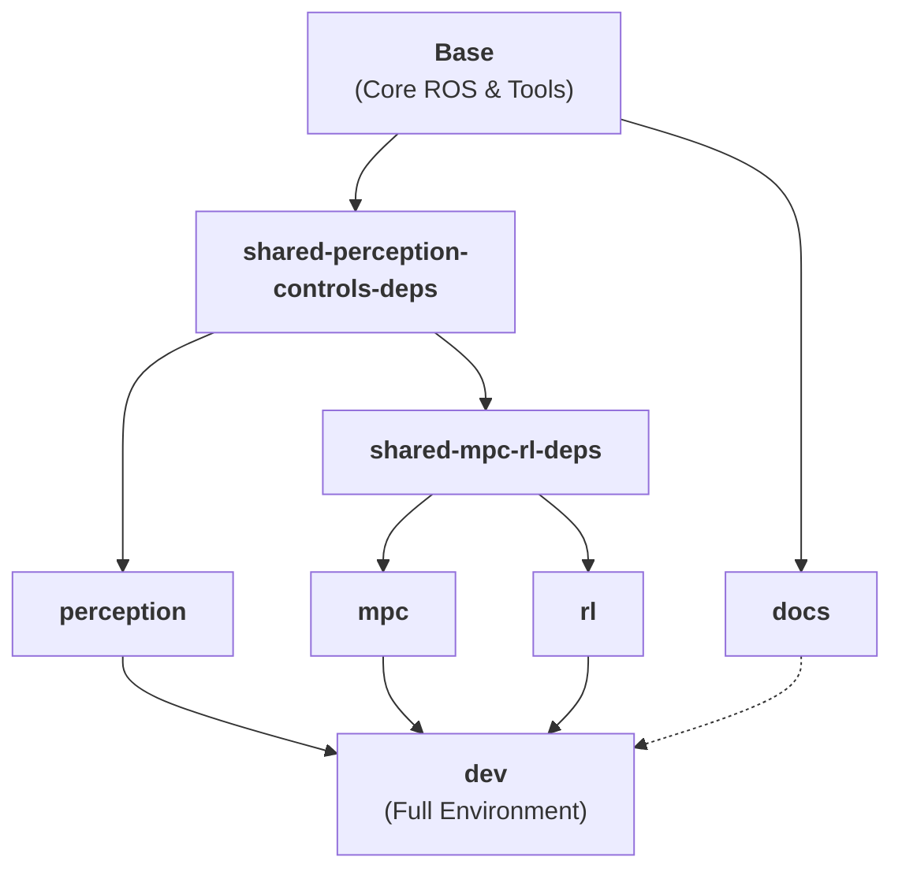

# Getting Started

**Page Owner:** [Leads of the Aeronautics Division](https://github.com/orgs/ETHRoboticsClub/teams/aeronautics/)

---

This repository provides a ready-to-use drone racing environment using Docker. By containerizing the development environment, we ensure consistency across different host systems and simplify the setup of complex robotics software.

## Environment Overview

The environment bundles the following core components:

*   **ROS 2 Humble**: Our primary robotics framework.
*   **Gazebo (gz)**: A high-fidelity 3D simulator for drones.
*   **PX4 SITL**: The autopilot software running in simulation.
*   **MAVROS / MAVSDK**: Communication bridges between PX4 and ROS.
*   **Workspace (`/ws`)**: The location for custom ROS 2 packages.

> [!IMPORTANT]
> **Host OS**: Ubuntu/Linux is highly recommended for GUI compatibility.  
> **Requirements**: Docker Engine + Compose v2.

---

## Docker Infrastructure



### Build Targets

- **`base`**: The core foundation containing ROS 2, system tools, and base dependencies.
- **`docs`**: A lightweight environment for building and serving this documentation.
- **`perception`**: Specialized for camera-based tracking and state estimation (OpenVINS, Gate Detection).
- **`mpc`**: Optimized for high-performance controls and trajectory tracking (MAVSDK, ACADOS).
- **`rl`**: Includes neural network and reinforcement learning libraries (PyTorch, Stable Baselines 3).
- **`dev`**: The complete, integrated environment containing all components above.

---

## Quick Start

Follow these steps to get the environment running.

### Step 0: SSH Setup
We use SSH for Git operations to avoid repeated password prompts.  
[Follow GitHub's SSH guide here](https://docs.github.com/en/authentication/connecting-to-github-with-ssh).

### Step 1: Clone the Repository
Ensure you clone with submodules to include the PX4 Autopilot.
```bash
git clone --recurse-submodules git@github.com:ETHRoboticsClub/ETHRC-Drone-Racing.git
cd ETHRC-Drone-Racing
git submodule update --init --recursive
```

### Step 2: Build and Prepare
Build the Docker image and prepare the host volumes for ROS 2. We use multi-stage builds to provide specialized environments for different teams.

```bash
# To build the FULL development environment (Default)
docker compose build dev

# To build only for the Perception team
docker compose build perception

# To build only for the MPC / Control team
docker compose build mpc

# To build only for the RL team
docker compose build rl

# To build ONLY the documentation
docker compose build docs
```

Ensure host volumes are prepared:
```bash
./scripts/prepare_colcon_volumes.sh
```

### Step 3: Start Services
Allow GUI applications and start your preferred container target.

```bash
xhost +local:root

# Start the full environment
docker compose up dev -d

# OR start a specific team environment
docker compose up mpc -d
```

### Step 4: Access and Build
Attach to the running container and build the workspace.

```bash
docker compose exec dev bash

# Inside the container:
colcon build --symlink-install --cmake-args -DCMAKE_BUILD_TYPE=RelWithDebInfo
```

#### Build Command Breakdown

- **`--symlink-install`**: Instead of copying files, ROS 2 creates symbolic links to your source files. This means changes to Python scripts or configuration files take effect **instantly** without needing another build.
- **`-DCMAKE_BUILD_TYPE=RelWithDebInfo`**: Compiles with optimizations (for performance) while keeping debug symbols (for troubleshooting).

> [!IMPORTANT]
> ### 💡 Sourcing the Workspace
> After building, or whenever you open a **new terminal tab**, you MUST source the workspace to make the packages visible to ROS 2:
> ```bash
> source install/setup.bash
> ```
> If you omit this, you will see `Package 'drone_control' not found` errors.

---

---

## Flying the Drone

Once the simulation and controller are running, you can command the drone using our standard goal-sending utilities.

### Step 1: Launch the Controller
In a container terminal, start the MPC controller:
```bash
ros2 launch drone_control drone_controller.launch.py
```

### Step 2: Send a Pose Goal (Takeoff)
In a **separate** container terminal, use the `send_pose_goal` script to command a takeoff to 2 meters:
```bash
ros2 run drone_control send_pose_goal goal_only -x 0.0 -y 0.0 -z 2.0 -yaw 90
```

#### Argument Breakdown

| Argument | Description |
| :--- | :--- |
| `goal_only` | Sends the goal and waits for completion. Use `cancel` to stop an active mission. |
| `-x`, `-y`, `-z` | Target coordinates in meters. |
| `-yaw` | Target orientation in **degrees**. |

### Step 3: Monitor in PlotJuggler
The controller launch automatically opens PlotJuggler. Look for the `/drone_state_sim` and `/drone_current_target` topics to verify the drone is tracking the reference accurately.

---

## Running Simulation

To launch the default simulation environment:

1.  **Source the workspace**:
    ```bash
    source install/setup.bash
    ```
2.  **Launch PX4 SITL with Gazebo** (pick one):
    ```bash
    cd /home/drone_dev/ros_ws/px4/PX4-Autopilot
    make px4_sitl gz_drone       # ETHRC custom drone (airframe 4023)
    make px4_sitl gz_x500_cam    # x500 with front camera (airframe 4022)
    ```

---

## Visualization and Monitoring

Visualizing the internal state of the drone is crucial for debugging perception and control algorithms.

### RViz Visualization
We use RViz2 to visualize sensor data, gate detections, and EKF state.

### Full Perception Launch
You can launch the integrated perception stack (VIO + Gate Detection + EKF) using:
```bash
source install/setup.bash
ros2 launch launch/perception.launch.py
```

---

## Troubleshooting & Common Issues

### Permission Errors
If you see permission denied errors during build or when accessing volumes, run the preparation script on the **host**:
```bash
sudo ./scripts/prepare_colcon_volumes.sh
```

### Submodule Issues
If the build fails due to missing source files in `src/perception/VIO` or `src/ros2-vicon-receiver`, ensure your submodules are up to date:
```bash
git submodule update --init --recursive
```

### Package Not Found After Docker Compose Up
If `ros2 launch` fails with "Package not found", the host's empty `.colcon/install` volume is masking the container's build. Rebuild inside the container:
```bash
colcon build --symlink-install --cmake-args -DCMAKE_BUILD_TYPE=RelWithDebInfo
source install/setup.bash
```


---

---

## Native Execution (Non-Docker)

While Docker is great for simulation and development on a workstation, you may want to run part of the stack **natively** on your companion computer (e.g., Jetson Orin NX) to reduce overhead or access specific hardware pins.

### 1. Prerequisites
Ensure you have ROS 2 installed on your host system (this project targets **Humble**, though it is compatible with **Jazzy**). 
```bash
# Example for installing colcon
sudo apt update && sudo apt install python3-colcon-common-extensions
```

### 2. Build the Workspace
From the project root:
```bash
colcon build --symlink-install --cmake-args -DCMAKE_BUILD_TYPE=Release
```

### 3. Fast Bringup (The "Big Button")
Once built, you can launch the entire racing stack across all modules (Comms, Perception, and Control) using the unified bringup script:

```bash
source install/setup.bash
ros2 launch drone_control racing_bringup.launch.py msp_port:=/dev/ttyTHS1
```

### 4. Configuration Tips
- **Serial Ports:** If you are using a USB-to-Serial adapter instead of the internal UART, use `msp_port:=/dev/ttyUSB0`.
- **Persisting Settings:** You can edit the default parameters in `src/betaflight_msp_controller/config/msp_params.yaml` so you don't have to pass them every time.

### 5. MSP Bench Mode
When testing the drone on a bench without a physical RC transmitter, you can use the MSP Bench Mode. This provides an interactive TUI to emulate a remote controller directly over the MSP protocol.

```bash
# Launch the bringup with bench mode enabled
ros2 launch drone_control racing_bringup.launch.py msp_bench_mode:=true

# In a separate terminal, run the standalone TX emulator TUI
ros2 run betaflight_msp_controller msp_tx_emulator
```

> [!WARNING]
> **Serial Port Contention:** When `msp_bench_mode:=true` is used, the `msp_bridge` node is explicitly disabled to free up the serial port for the TX emulator. You must run the `msp_tx_emulator` in another terminal to send commands to the drone.

#### Betaflight Configuration
Bench mode requires specific settings in Betaflight (e.g., disabling physical RX, enabling MSP overrides). While we provide a `load_bf_config` flag in the launch file to attempt automatic loading, it is **unreliable** due to the timing-sensitive nature of serial CLI handshakes.

**It is strongly recommended to manually load the configuration using the Betaflight Configurator:**
1.  Open Betaflight Configurator.
2.  Go to the **CLI** tab.
3.  Copy the contents of `docs/docs/files/betaflight_conf/ZEPHYRUS_MSP_BENCH.txt`.
4.  Paste it into the CLI and type `save`.
5.  To revert to flight mode, repeat the process with `docs/docs/files/betaflight_conf/zephyrus_KAKUTEH7.txt`.

---

## Next Steps

Now that your environment is set up, explore the following resources:

*   [**Perception Modules**](perception/index.md): Learn about VIO, Gate Detection, and state estimation.
*   [**Control Algorithms**](controls/index.md): Understand MPC and RL-based drone control.
*   [**Betaflight MSP Control**](controls/msp_control.md): Deep dive into the hardware bridge and serial configuration.
*   [**Development Guidelines**](guidelines.md): Review our coding standards and Git workflow.
