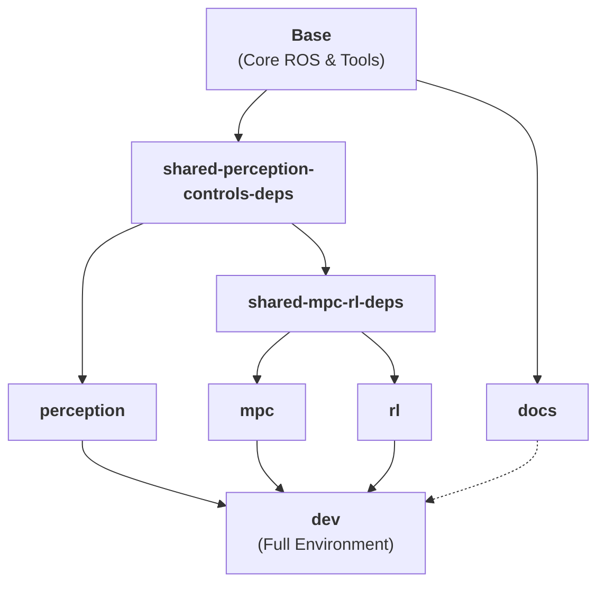

# Getting Started

**Page Owner:** [Leads of the Aeronautics Division](https://github.com/orgs/ETHRoboticsClub/teams/aeronautics/)

---

This repository provides a ready-to-use drone racing environment using Docker. By containerizing the development environment, we ensure consistency across different host systems and simplify the setup of complex robotics software.

## Environment Overview

The environment bundles the following core components:

*   **ROS 2 Humble**: Our primary robotics framework.
*   **Gazebo (gz)**: A high-fidelity 3D simulator for drones.
*   **PX4 SITL**: The autopilot software running in simulation.
*   **MAVROS / MAVSDK**: Communication bridges between PX4 and ROS.
*   **Workspace (`/ws`)**: The location for custom ROS 2 packages.

> [!IMPORTANT]
> **Host OS**: Ubuntu/Linux is highly recommended for GUI compatibility.  
> **Requirements**: Docker Engine + Compose v2.

---

## Docker Infrastructure



### Build Targets

- **`base`**: The core foundation containing ROS 2, system tools, and base dependencies.
- **`docs`**: A lightweight environment for building and serving this documentation.
- **`perception`**: Specialized for camera-based tracking and state estimation (OpenVINS, ArUco).
- **`mpc`**: Optimized for high-performance controls and trajectory tracking (MAVSDK, ACADOS).
- **`rl`**: Includes neural network and reinforcement learning libraries (PyTorch, Stable Baselines 3).
- **`dev`**: The complete, integrated environment containing all components above.

---

## Quick Start

Follow these steps to get the environment running.

### Step 0: SSH Setup
We use SSH for Git operations to avoid repeated password prompts.  
[Follow GitHub's SSH guide here](https://docs.github.com/en/authentication/connecting-to-github-with-ssh).

### Step 1: Clone the Repository
Ensure you clone with submodules to include the PX4 Autopilot.
```bash
git clone --recurse-submodules git@github.com:ETHRoboticsClub/ETHRC-Drone-Racing.git
cd ETHRC-Drone-Racing
git submodule update --init --recursive
```

### Step 2: Build and Prepare
Build the Docker image and prepare the host volumes for ROS 2. We use multi-stage builds to provide specialized environments for different teams.

```bash
# To build the FULL development environment (Default)
docker compose build dev

# To build only for the Perception team
docker compose build perception

# To build only for the MPC / Control team
docker compose build mpc

# To build only for the RL team
docker compose build rl

# To build ONLY the documentation
docker compose build docs
```

Ensure host volumes are prepared:
```bash
./scripts/prepare_colcon_volumes.sh
```

### Step 3: Start Services
Allow GUI applications and start your preferred container target.

```bash
xhost +local:root

# Start the full environment
docker compose up dev -d

# OR start a specific team environment
docker compose up mpc -d
```

### Step 4: Access and Build
Attach to the running container and build the workspace.

```bash
docker compose exec dev bash

# Inside the container:
colcon build --symlink-install --cmake-args -DCMAKE_BUILD_TYPE=RelWithDebInfo
```

---

---

## Flying the Drone

Once the simulation and controller are running, you can command the drone using our standard goal-sending utilities.

### Step 1: Launch the Controller
In a container terminal, start the MPC controller:
```bash
ros2 launch drone_control drone_controller.launch.py
```

### Step 2: Send a Pose Goal (Takeoff)
In a **separate** container terminal, use the `send_pose_goal` script to command a takeoff to 2 meters:
```bash
# General Format: ros2 run drone_control send_pose_goal <mode> -x <x> -y <y> -z <z> -yaw <degrees>
ros2 run drone_control send_pose_goal goal_only -x 0.0 -y 0.0 -z 2.0 -yaw 90
```

### Step 3: Monitor in PlotJuggler
The controller launch automatically opens PlotJuggler. Look for the `/drone_state_sim` and `/drone_current_target` topics to verify the drone is tracking the reference accurately.

---

## Running Simulation

To launch the default simulation environment:

1.  **Source the workspace**:
    ```bash
    source install/setup.bash
    ```
2.  **Launch PX4 SITL with Gazebo**:
    ```bash
    cd /home/drone_dev/ros_ws/px4/PX4-Autopilot
    make px4_sitl gz_x500_mono_cam 
    ```

---

## Visualization and Monitoring

Visualizing the internal state of the drone is crucial for debugging perception and control algorithms.

### RViz Visualization
We use RViz2 to visualize sensor data, ArUco detections, and EKF state. To launch RViz with the ArUco monitor:
```bash
source install/setup.bash
ros2 launch aruco_pose_estimation aruco_pose_estimation.launch.py rviz:=true
```

### Full Perception Launch
You can launch the integrated perception stack (VIO + ArUco + EKF) using:
```bash
source install/setup.bash
ros2 launch launch/perception.launch.py
```

---

## Troubleshooting & Common Issues

### Permission Errors
If you see permission denied errors during build or when accessing volumes, run the preparation script on the **host**:
```bash
sudo ./scripts/prepare_colcon_volumes.sh
```

### Submodule Issues
If the build fails due to missing source files in `src/perception/VIO` or `src/ros2-vicon-receiver`, ensure your submodules are up to date:
```bash
git submodule update --init --recursive
```

### Package Not Found After Docker Compose Up
If `ros2 launch` fails with "Package not found", the host's empty `.colcon/install` volume is masking the container's build. Rebuild inside the container:
```bash
colcon build --symlink-install --cmake-args -DCMAKE_BUILD_TYPE=RelWithDebInfo
source install/setup.bash
```


---

## Next Steps

Now that your environment is set up, explore the following resources:

*   [**Perception Modules**](perception/index.md): Learn about VIO, ArUco tracking, and state estimation.
*   [**Control Algorithms**](controls/index.md): Understand MPC and RL-based drone control.
*   [**Development Guidelines**](guidelines.md): Review our coding standards and Git workflow.
