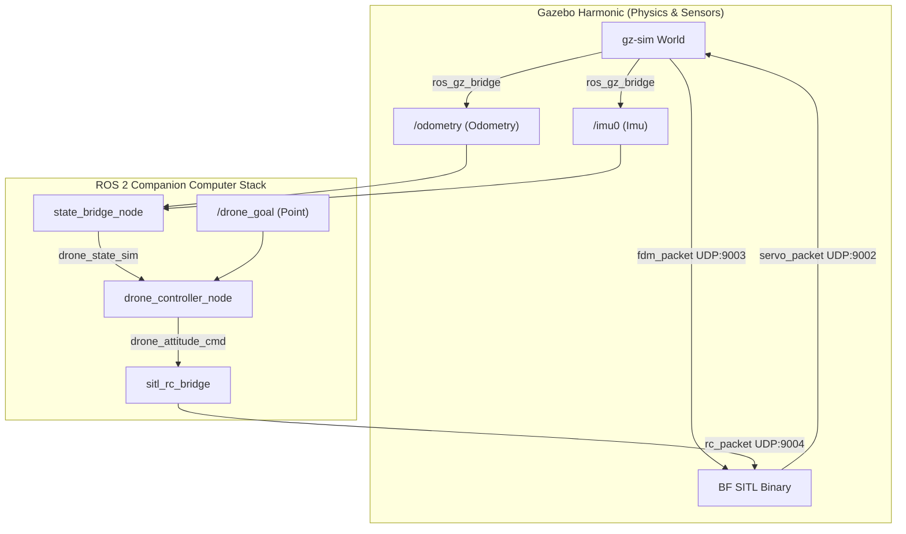

# SITL Simulation & Verification

**Page Owner:** [Leads of the Aeronautics Division](https://github.com/orgs/ETHRoboticsClub/teams/aeronautics/)

---

Software-in-the-Loop (SITL) simulation allows you to test and verify the entire autonomous flight control stack, including neural network RL policies and perception estimators, without risking physical drone hardware.

The SITL environment integrates **Gazebo Harmonic** (for physical world simulation and sensors) with the **Betaflight SITL firmware** (running the same flight-control loops as the real drone) in a closed-loop setup.

---

## 🏗️ Architecture Overview

The simulation mirrors the real-world drone architecture by replacing hardware interfaces with UDP sockets and ROS 2 bridges:



* **Gazebo** simulates the `drone_sitl` body dynamics, IMU, and odometry. The verified SITL path applies physical thrust directly from decoded Betaflight motor outputs in the Gazebo `BetaflightPlugin`, with a small virtual launch pad to avoid unstable ODE ground contact.
* **Betaflight SITL** receives simulated FDM packets from Gazebo on UDP port `9003`, reads RC input on UDP port `9004`, and sends motor outputs back to Gazebo on UDP port `9002`.
* **`sitl_rc_bridge`** bridges ROS 2 `/joy` and controller commands into Betaflight SITL RC packets.

---

## 🛠️ Setup & Build Instructions

Before running the simulation, you must install the Gazebo ROS bridges and compile the simulation plugins and flight firmware.

### 1. Full Bootstrap

```bash
# From the workspace root
./scripts/setup_sitl.sh
```

This script will:

1. Install **Gazebo Harmonic** and the matching ROS/Gazebo bridge packages.
2. Clone or update `ext/aeroloop_gazebo` and build the C++ `BetaflightPlugin`.
3. Clone or update `ext/anemos-betaflight` and build the Betaflight SITL target.
4. Load `docs/docs/files/betaflight_conf/sitl_config.txt` into `eeprom.bin`.
5. Run `colcon build --symlink-install --packages-up-to drone_control betaflight_msp_controller gazebo_ros_bridges`.

!!! note
    `setup_sitl.sh` fetches external repositories. On a development branch with local edits inside `ext/aeroloop_gazebo` or `ext/anemos-betaflight`, use the manual rebuild commands below instead of re-running the bootstrap script.

### 2. Manual Rebuild After Local Changes

Use this when dependencies are already installed and you only need to rebuild the checked-out source:

```bash
# Gazebo Betaflight plugin
ext/aeroloop_gazebo/build_plugin.sh

# Betaflight SITL firmware
cd ext/anemos-betaflight
make TARGET=SITL -j$(nproc)
cd ../..

# Regenerate eeprom.bin from the SITL Betaflight CLI config
ext/anemos-betaflight/obj/main/betaflight_SITL.elf \
  --config docs/docs/files/betaflight_conf/sitl_config.txt

# ROS packages
source /opt/ros/humble/setup.bash
colcon build --symlink-install \
  --packages-up-to drone_control betaflight_msp_controller gazebo_ros_bridges
```

### 3. Preflight Port Check

Before launching, make sure no previous SITL/Gazebo process is still holding the UDP ports:

```bash
ss -ulpn | rg '900[234]' || true
```

Expected output before launch is empty. If a previous run is still listed, stop it with `Ctrl-C` in that terminal or kill only the stale SITL/Gazebo processes:

```bash
pkill -f 'gz sim .*sitl_racing.sdf' || true
pkill -f 'betaflight_SITL' || true
pkill -f 'sitl_rc_bridge' || true
```

Re-run the `ss` command and only launch once ports `9002`, `9003`, and `9004` are free.

### 4. Python Dependencies (PyTorch)
The `drone_controller_node` runs the neural network policy and requires PyTorch. You can run it either:
* **Natively on the host**: Install CPU-only PyTorch:
  ```bash
  pip3 install --user torch --index-url https://download.pytorch.org/whl/cpu
  ```
* **Inside Docker**: Ensure you execute the launch commands inside the Docker environment (`docker compose exec dev bash`), where the full ML/RL stack is pre-configured.

---

## 🚀 Launching the Simulation

You can launch the complete simulation loop (Gazebo server, Betaflight firmware, ROS topic bridges, state bridge, controller, and RC bridge) using a single bringup command.

```bash
source /opt/ros/humble/setup.bash
source install/setup.bash

export GZ_SIM_RESOURCE_PATH="$PWD/sim/gazebo/models:${GZ_SIM_RESOURCE_PATH}"
export GZ_SIM_SYSTEM_PLUGIN_PATH="$PWD/ext/aeroloop_gazebo/plugins/build:${GZ_SIM_SYSTEM_PLUGIN_PATH}"

ros2 launch drone_control racing_bringup.launch.py \
  sitl:=true \
  view_stream:=false \
  publish_raw:=false \
  publish_rgb:=false \
  use_vio:=false \
  use_ekf:=false \
  controller_type:=rl
```

### Headless vs. GUI Mode
By default, the simulation starts Gazebo in **headless mode** (running only the physics server `gz-sim-server`) to minimize resource consumption and avoid graphical driver issues.

If you want to spawn the graphical interface to visually monitor the drone, open another terminal and start the Gazebo GUI:

```bash
gz sim -g
```

---

## 🎯 Verification: Manual Throttle Takeoff

The fastest end-to-end check is to emulate a joystick, arm Betaflight, and command full throttle while sampling `/odometry`.

Keep the bringup running in terminal 1. In terminal 2, run:

```bash
source /opt/ros/humble/setup.bash
source install/setup.bash

python3 - <<'PY'
import time
import rclpy
from rclpy.node import Node
from sensor_msgs.msg import Joy
from nav_msgs.msg import Odometry

class SitlVerifier(Node):
    def __init__(self):
        super().__init__("sitl_manual_throttle_verifier")
        self.pub = self.create_publisher(Joy, "/joy", 10)
        self.z = None
        self.vz = None
        self.create_subscription(Odometry, "/odometry", self.odom_cb, 10)

    def odom_cb(self, msg):
        self.z = msg.pose.pose.position.z
        self.vz = msg.twist.twist.linear.z

    def send_joy(self, throttle_axis, armed):
        msg = Joy()
        msg.header.stamp = self.get_clock().now().to_msg()
        msg.header.frame_id = "sitl_verify"
        msg.axes = [0.0, 0.0, 0.0, float(throttle_axis)]
        msg.buttons = [0, 0, 0, 0, 1 if armed else 0, 0, 0, 0]
        self.pub.publish(msg)

    def phase(self, name, throttle_axis, armed, seconds):
        samples = []
        start = time.time()
        last_print = 0.0
        while time.time() - start < seconds:
            self.send_joy(throttle_axis, armed)
            rclpy.spin_once(self, timeout_sec=0.01)
            if self.z is not None:
                samples.append(self.z)
            elapsed = time.time() - start
            if elapsed - last_print >= 1.0 and self.z is not None:
                print(f"{name}: z={self.z:.3f} vz={self.vz:.3f}", flush=True)
                last_print = elapsed
            time.sleep(0.01)
        if samples:
            print(
                f"{name}: start={samples[0]:.3f} end={samples[-1]:.3f} "
                f"min={min(samples):.3f} max={max(samples):.3f}",
                flush=True,
            )

rclpy.init()
node = SitlVerifier()

deadline = time.time() + 2.0
while node.z is None and time.time() < deadline:
    rclpy.spin_once(node, timeout_sec=0.1)

print(f"initial: z={node.z:.3f} vz={node.vz:.3f}", flush=True)
node.phase("armed_low", -1.0, True, 2.0)
node.phase("full_throttle", 1.0, True, 4.0)
node.phase("disarm", -1.0, False, 0.4)

node.destroy_node()
rclpy.shutdown()
PY
```

Expected result:

* `armed_low` stays near the virtual pad height (`z ~= 0.5`).
* `full_throttle` increases `z` clearly within a few seconds.

Known-good verification output from the repaired environment:

```text
initial: z=0.500 vz=0.006
armed_low: start=0.500 end=0.498 min=0.498 max=0.500
full_throttle: start=0.498 end=16.761 min=0.498 max=16.761
```

Stop the bringup with `Ctrl-C` after verification.

---

## 🎯 Verification: Testing the RL Hover Policy

The bringup command starts `drone_controller_node` with `controller_type:=rl`, so the controller is already waiting for a state stream and a target goal.

### 1. Publish a Target Goal
Instruct the drone to hover at a height of 1.5 meters:

```bash
ros2 topic pub /drone_goal geometry_msgs/msg/Point "{x: 0.0, y: 0.0, z: 1.5}" --once
```

### 2. Verify Active Telemetry
In a separate terminal, monitor the rates of the key control loop topics to ensure they are streaming at the target frequencies (~100Hz):

```bash
ros2 topic hz /drone_state_sim
ros2 topic hz /drone_observation
ros2 topic hz /drone_attitude_cmd
```

You can also check the Gazebo sensor ingress topics:

```bash
ros2 topic hz /imu0
ros2 topic hz /odometry
```

---

## 🎮 Manual Control / TUI Control (Emulating /joy)

To manually fly, arm, or override the drone during SITL simulation, you can run the terminal-based Joy Emulator. It publishes standard `sensor_msgs/msg/Joy` messages to the `/joy` topic, which the `sitl_rc_bridge` node listens to for arming and override inputs.

To launch the emulator in a new terminal:

```bash
source /opt/ros/humble/setup.bash
source install/setup.bash
ros2 run betaflight_msp_controller joy_tx_emulator
```

### Controls Layout
* **Pitch / Roll**: `W`/`S` (Pitch) & `A`/`D` (Roll)
* **Throttle / Yaw**: `Up`/`Down` arrows (Throttle) & `Left`/`Right` arrows (Yaw)
* **AUX / Modes**:
  * `Space`: Toggle ARM/DISARM (AUX 1 / Button 4)
  * `2`: Toggle Override control (AUX 2 / Button 5)
  * `3` / `4`: Toggle AUX 3 / AUX 4 (Buttons 6 & 7)
* **Utilities**:
  * `C`: Center all attitude/yaw sticks (Roll, Pitch, Yaw)
  * `R`: Reset throttle stick to minimum (`-1.0`)
  * `Q`: Quit the TUI emulator safely

---

## ⚙️ Configuration & Customization

* **Gazebo World File**: Defined in `sim/gazebo/worlds/sitl_racing.sdf`. Modify this file to add obstacles, gates, or custom lighting.
* **Drone Physical Properties**: Defined in the Gazebo SDF model at `sim/gazebo/models/drone_sitl/model.sdf`. Adjust mass, inertia, and motor coefficients to match custom frames.
* **Betaflight Configuration**: CLI parameters for the SITL flight controller are located in `docs/docs/files/betaflight_conf/sitl_config.txt`.

---

## 🧩 Repair Notes and Findings

These are the important implementation details behind the currently verified SITL path.

### BetaflightPlugin (`ext/aeroloop_gazebo`)

* The Gazebo plugin must load from `ext/aeroloop_gazebo/plugins/build`; export `GZ_SIM_SYSTEM_PLUGIN_PATH` before launching.
* The FDM packet ABI sent to Betaflight must match the SITL firmware. The packet includes `timestamp`, IMU angular velocity, IMU linear acceleration, quaternion, velocity, position, and `pressure`.
* The rotor velocity PID sign must be `velTarget - vel`. The inverted sign drives the rotor joints away from the requested target.
* Motor UDP receive should drain all queued datagrams and use the newest valid `servo_packet`. A one-packet blocking receive can let port `9002` build a backlog and stale motor commands.
* The SDF `LiftDrag` rotor path was not sufficient for verified takeoff in this model. The working path applies direct world force from decoded normalized motor outputs and keeps the model on a small virtual launch pad before takeoff.

### Gazebo SDF

* The base collision in `sim/gazebo/models/drone_sitl/model.sdf` is a simple box. Mesh collision and rotor collisions caused unstable contact behavior.
* The `sitl_racing.sdf` ground plane is visual-only. The previous physical ground collision triggered DART/ODE AABB aborts during SITL.

### Betaflight SITL (`ext/anemos-betaflight`)

* UDP RX is treated as a held latest-value stream after the first valid packet. This prevents FC-time RXLOSS between wall-time UDP packets.
* `RX_PROVIDER_UDP` starts with the full supported channel count so the first UDP RC packet is consumed.
* Motor output packets are sent continuously from `pwmCompleteMotorUpdate()`; they are not gated by the old FDM update mutex.

### `sitl_rc_bridge`

* The UDP RC heartbeat runs at `500 Hz`. Betaflight SITL can advance FC time faster than wall time, so `50 Hz` can be too slow.
* Manual `/joy` axes map directly to Roll, Pitch, Throttle, and Yaw when override is disabled.
* AUX2 is held low in SITL so Betaflight does not enter `BOXMSPOVERRIDE` and ignore the UDP RX stream.

### Debugging Checklist

If the drone arms but does not climb:

1. Confirm Betaflight sees RC input:
   ```text
   rcData ... T:2000 ... A1:2000 ... boxarm:1 armed:1
   ```
2. Confirm Gazebo owns motor UDP port `9002`:
   ```bash
   ss -ulpn | rg '900[234]'
   ```
3. Confirm `/odometry` is streaming:
   ```bash
   ros2 topic hz /odometry
   ```
4. Rebuild the three moving pieces:
   ```bash
   ext/aeroloop_gazebo/build_plugin.sh
   (cd ext/anemos-betaflight && make TARGET=SITL -j$(nproc))
   colcon build --symlink-install --packages-up-to drone_control betaflight_msp_controller gazebo_ros_bridges
   ```
