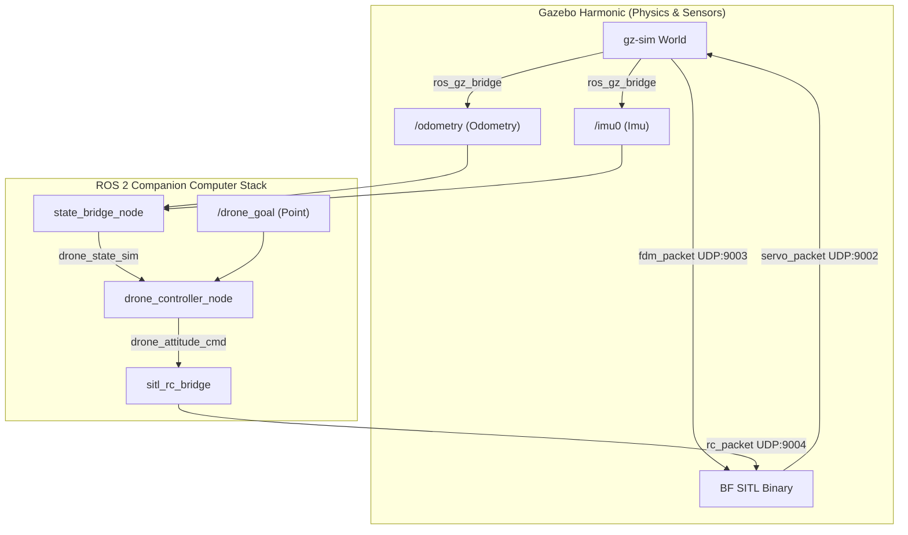

# SITL Simulation & Verification

**Page Owner:** [Leads of the Aeronautics Division](https://github.com/orgs/ETHRoboticsClub/teams/aeronautics/)

---

Software-in-the-Loop (SITL) simulation allows you to test and verify the entire autonomous flight control stack, including neural network RL policies and perception estimators, without risking physical drone hardware. 

The SITL environment integrates **Gazebo Harmonic** (for physical world simulation, aerodynamics, and sensors) with the **Betaflight SITL firmware** (running the exact same flight control loops as the real drone) in a closed-loop setup.

---

## 🏗️ Architecture Overview

The simulation mirrors the real-world drone architecture by replacing hardware interfaces with UDP sockets and ROS 2 bridges:



* **Gazebo** simulates the drone body dynamics (`drone_sitl` model) using `LiftDrag` plugins for rotor forces and publishes true IMU/Odometry data.
* **Betaflight SITL** receives the simulated motor speeds from Gazebo and runs its PID loops to compute attitude command responses.
* **`sitl_rc_bridge`** bridges the ROS 2 controller's attitude command rates and thrust back into the Betaflight SITL receiver over UDP (port 9004).

---

## 🛠️ Setup & Build Instructions

Before running the simulation, you must install the Gazebo ROS bridges and compile the simulation plugins and flight firmware.

### 1. Run the Auto-Setup Script
We provide a unified configuration script that automates package installation and compilation of external code:

```bash
# From the workspace root
./scripts/setup_sitl.sh
```

This script will:
1. Install **Gazebo Harmonic** and the correct **`ros-humble-ros-gzharmonic-bridge`** and **`ros-humble-ros-gzharmonic-sim`** package dependencies on your host workstation. (Note: standard `ros-humble-ros-gz` is for Gazebo Fortress and will cause topic decoding failures like `Unknown message type [8]`).
2. Clone and build the **`aeroloop_gazebo`** plugins (containing the C++ `BetaflightPlugin` system plugin).
3. Compile the custom **Betaflight SITL binary** inside `ext/anemos-betaflight`.
4. Run `colcon build --symlink-install` to compile the ROS 2 workspace packages (always use `--symlink-install` to prevent stale build copy errors in Python nodes).

### 2. Python Dependencies (PyTorch)
The `drone_controller_node` runs the neural network policy and requires PyTorch. You can run it either:
* **Natively on the host**: Install CPU-only PyTorch:
  ```bash
  pip3 install --user torch --index-url https://download.pytorch.org/whl/cpu
  ```
* **Inside Docker**: Ensure you execute the launch commands inside the Docker environment (`docker compose exec dev bash`), where the full ML/RL stack is pre-configured.

---

## 🚀 Launching the Simulation

You can launch the complete simulation loop (Gazebo server, Betaflight firmware, ROS topic bridges, state estimators, and RC override bridge) using a single bringup command:

```bash
source install/setup.bash
ros2 launch drone_control racing_bringup.launch.py sitl:=true controller_type:=rl
```

### Headless vs. GUI Mode
By default, the simulation starts Gazebo in **headless mode** (running only the physics server `gz-sim-server`) to minimize resource consumption and avoid graphical driver issues.

If you want to spawn the graphical interface to visually monitor the drone, open another terminal and start the Gazebo GUI:

```bash
gz sim -g
```

---

## 🎯 Verification: Testing the RL Hover Policy

The bringup command above starts `drone_controller_node` with `controller_type:=rl`, so the controller is already waiting for a state stream and a target goal.

### 1. Publish a Target Goal
Instruct the drone to hover at a height of 1.5 meters:

```bash
ros2 topic pub /drone_goal geometry_msgs/msg/Point "{x: 0.0, y: 0.0, z: 1.5}" --once
```

### 2. Verify Active Telemetry
In a separate terminal, monitor the rates of the key control loop topics to ensure they are streaming at the target frequencies (~100Hz):

```bash
ros2 topic hz /drone_state_sim
ros2 topic hz /drone_observation
ros2 topic hz /drone_attitude_cmd
```

You can also check the Gazebo sensor ingress topics:

```bash
ros2 topic hz /imu0
ros2 topic hz /odometry
```

---

## ⚙️ Configuration & Customization

* **Gazebo World File**: Defined in `sim/gazebo/worlds/sitl_racing.sdf`. Modify this file to add obstacles, gates, or custom lighting.
* **Drone Physical Properties**: Defined in the Gazebo SDF model at `sim/gazebo/models/drone_sitl/model.sdf`. Adjust mass, inertia, and motor coefficients to match custom frames.
* **Betaflight Configuration**: CLI parameters for the SITL flight controller are located in `docs/docs/files/betaflight_conf/sitl_config.txt`.
