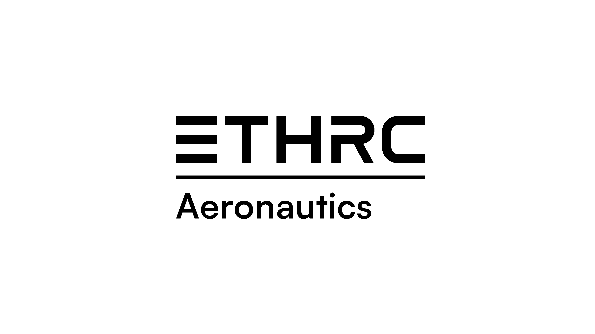

# ETHRC Drone Racing

**Page Owner:** [Members of the Aeronautics Division](https://github.com/orgs/ETHRoboticsClub/teams/aeronautics/)

---

Welcome to the ETHRC Drone Racing project documentation! This repository provides a complete development environment for drone racing research and development.

Everyone in the project is free to commit changes to the docs and we really encourage you to do so!
If you are unsure whether the information belongs here or on our Notion page, then feel free to ask.
Otherwise the answer to the question ***"If the repo goes public, would this be relevant to them?"*** should guide your decision. Generally anything technical (implementation details, technical decisions etc.) belong here.

Please note that some pages have a responsible person but you can do a pull request for changes any time.

## What's New? (Feb 2026)

- **System Stability**: Fixed MPC and MAVSDK compatibility issues for smoother simulation takeoff.
- **Enhanced Perception**: Correctly integrated `open_vins` and `ros2-vicon-receiver` as submodules.
- **Visualization Suite**: New instructions for RViz and Gazebo monitoring are now available in the [**Getting Started**](getting-started.md#visualization-and-monitoring) guide.

**[Read the full summary of recent changes here &raquo;](updates.md)**

## Quick Links

- [**Getting Started**](getting-started.md): Set up your environment and run your first simulation.
- [**Guidelines**](guidelines.md): Learn about our documentation standards and development workflow.
- [**Perception**](perception/index.md): Documentation for the Perception team and modules.
- [**Controls**](controls/index.md): Documentation for the Controls team and algorithms.
- [**Hardware**](hardware/index.md): Documentation for the Hardware team and electronics.
- [**Groundstation**](groundstation/index.md): Documentation for the Groundstation team and software.

## Project Layout

The project is organized as follows:

- **`docker/`**: Configuration for the Docker environment.
- **`px4/`**: PX4 Autopilot source code submodule.
- **`docs/`**: Documentation source files (MkDocs).
    - **`docs/`**: Markdown content.
    - **`mkdocs.yml`**: Site configuration.
- **`src/`**: ROS 2 packages and source code.
    - **`perception/`**: Perception modules and algorithms.
    - **`utils/`**: Utility packages.
- **`launch/`**: Global launch files for the project (e.g., `perception.launch.py`).
- **`scripts/`**: Helper scripts for setup and running simulations.
- **`sim/`**: Simulation resources, including Gazebo worlds and models.
- **`docker-compose.yaml`**: Docker Compose definition for services and volumes.

## Getting Started

Check out the `README.md` in the root of the repository or [**Getting Started**](getting-started.md) for instructions on how to build and run the simulation.

## Subsystems
Find the following subsystems:

- [**Perception**](perception/index.md): Documentation for the Perception team and modules.
- [**Controls**](controls/index.md): Documentation for the Controls team and algorithms.
- [**Hardware**](hardware/index.md): Documentation for the Hardware team and electronics.
- [**Groundstation**](groundstation/index.md): Documentation for the Groundstation team and software.
