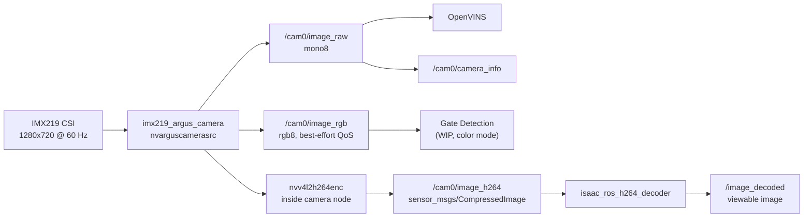

# Jetson Camera Pipeline

**Page Owner:** [Ilyas Seckin](https://github.com/ilysec)

This page is the source of truth for the live IMX219 camera path on Zephyrus.
The design priority is low-latency perception and recording. Raw color images
are available for gate detection and debugging, but flight logs should use the
hardware H.264 topic instead of bagging raw RGB.

## Runtime Architecture

The racing bringup captures the CSI camera once through `imx219_argus_camera`.
The node tees one Argus capture into mono, RGB, and optional hardware H.264
branches.



`/cam0/image_raw` is the canonical perception topic. It is published as `mono8`
with sensor-data QoS and queue depth 1 so slow consumers drop frames instead of
back-pressuring the camera. OpenVINS should subscribe here. Frames are rotated by
180 degrees by default in `argus_camera_node` (`flip_method: 2`) to match the
Zephyrus camera mount.

`/cam0/image_raw` does not contain color information. Use `/cam0/image_rgb` for
real color, including gate detection. The RGB topic is best-effort so slow
debugging tools do not back-pressure the camera pipeline.

`/cam0/image_h264` is compressed H.264 bytes produced by the Jetson hardware
encoder in the camera node when `h264_backend:=gstreamer_ros`. It is not a
displayable image. View `/image_decoded` after running the Isaac decoder.

## Jetson Setup

JetPack 6.2 may not auto-detect the IMX219. Configure the CSI connector once,
then reboot:

```bash
sudo /opt/nvidia/jetson-io/jetson-io.py
```

Select `Configure Jetson 24pin CSI connector`, then `Camera IMX219-A`.

Verify the sensor mode before debugging ROS:

```bash
v4l2-ctl --set-fmt-video=width=1280,height=720,pixelformat=RG10 \
  --stream-mmap --stream-count=300 -d /dev/video0
```

For Wi-Fi testing, disable power-save latency spikes:

```bash
sudo iw dev wlan0 set power_save off
```

## Native Dependencies

The native setup script installs the generic camera dependencies and attempts to
install the Isaac ROS H.264 decoder when the NVIDIA Isaac ROS apt repository is
available. On Jetson it may also install the Isaac encoder package for the
legacy `h264_backend:=isaac_ros` path, but the default path does not require it:

```bash
python3 scripts/tools/setup_native_dependencies.py
```

The default `h264_backend:=gstreamer_ros` path uses `nvv4l2h264enc` inside
`imx219_argus_camera`; no Isaac ROS encoder is needed on the Jetson. On the
ground station, the decoder package is required to visualize `/cam0/image_h264`.

## Drone Bringup

Perception-only smoke test:

```bash
ros2 launch drone_control racing_bringup.launch.py \
  msp_bench_mode:=true \
  view_stream:=false \
  use_gate_detection:=false \
  use_vio:=false
```

Perception plus hardware H.264 compression as a ROS topic:

```bash
ros2 launch drone_control racing_bringup.launch.py \
  msp_bench_mode:=true \
  view_stream:=true \
  h264_backend:=gstreamer_ros \
  use_gate_detection:=false \
  use_vio:=false
```

Gate detection with real color frames:

```bash
ros2 launch drone_control racing_bringup.launch.py \
  msp_bench_mode:=true \
  view_stream:=true \
  h264_backend:=gstreamer_ros \
  use_gate_detection:=true \
  gate_camera_topic:=/cam0/image_rgb
```

Local decode for debugging on the Jetson:

```bash
ros2 launch drone_control racing_bringup.launch.py \
  msp_bench_mode:=true \
  view_stream:=true \
  h264_backend:=gstreamer_ros \
  decode_h264:=true \
  use_gate_detection:=false \
  use_vio:=false
```

## Health Checks

Use rates first:

```bash
ros2 topic hz /cam0/image_raw
ros2 topic hz /cam0/image_rgb
ros2 topic hz /cam0/image_h264
```

Expected bench-mode behavior is that `/cam0/image_raw` and `/cam0/image_rgb`
stay close to the configured camera rate when the machine is not recording raw
RGB. `/cam0/image_h264` should be the topic used for color video recording.

Then inspect one compressed packet:

```bash
ros2 topic echo /cam0/image_h264 --once
```

A healthy `/cam0/image_h264` message has non-empty `data` and usually
`format: h264`. If a viewer shows a black image with an error marker, verify
that you are viewing `/image_decoded`, not `/cam0/image_h264`.

## Recording Guidance

For full-rate recording, prefer compressed video plus telemetry:

```bash
ros2 bag record \
  /cam0/image_h264 \
  /cam0/camera_info \
  /imu0 \
  /motor_rpm \
  /vicon/drone/drone \
  /odometry/filtered
```

Avoid recording `/cam0/image_rgb` during flight. It is roughly three times the
size of the mono stream and is a debug/gate-detection topic. Use
`/cam0/image_h264` for color flight video. Record `/cam0/image_raw` only for
short debug runs or when a raw-frame dataset is explicitly needed.

For bench tests with MSP override disabled, the recommended command is:

```bash
ros2 launch drone_control racing_bringup.launch.py \
  msp_bench_mode:=true \
  view_stream:=true \
  h264_backend:=gstreamer_ros \
  use_gate_detection:=false \
  use_vio:=false
```

## GStreamer Fallback

`h264_backend:=gstreamer` remains available as a low-level RTP/UDP debugging
path. It is not the default racing path because it bypasses the ROS H.264 topic
and is less convenient for ROS bagging.
