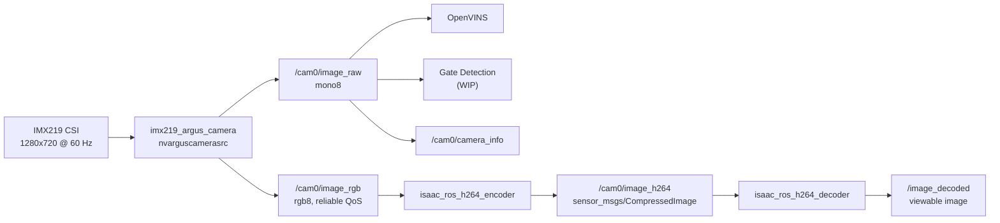

# Jetson Camera Pipeline

**Page Owner:** [Ilyas Seckin](https://github.com/ilysec)

This page is the source of truth for the live IMX219 camera path on Zephyrus.
The design priority is low-latency perception. Video streaming and recording are
secondary branches that must not take ownership of the camera away from VIO or
gate detection.

## Runtime Architecture

The racing bringup captures the CSI camera once through `imx219_argus_camera`.
The node publishes a mono perception image by default and can publish an
additional RGB branch only when the Isaac ROS H.264 encoder is enabled.



`/cam0/image_raw` is the canonical perception topic. It is published as `mono8`
with sensor-data QoS and queue depth 1 so slow consumers drop frames instead of
back-pressuring the camera. OpenVINS and gate detection should subscribe here.
Frames are rotated by 180 degrees by default in `argus_camera_node`
(`flip_method: 2`) to match the Zephyrus camera mount.

`/cam0/image_rgb` exists only to feed the Isaac ROS encoder. It is reliable QoS
because the Isaac encoder subscribes reliably. Do not use it for perception
unless a downstream node truly requires color.

`/cam0/image_h264` is compressed H.264 bytes, not a displayable image. View
`/image_decoded` after running the Isaac decoder.

## Jetson Setup

JetPack 6.2 may not auto-detect the IMX219. Configure the CSI connector once,
then reboot:

```bash
sudo /opt/nvidia/jetson-io/jetson-io.py
```

Select `Configure Jetson 24pin CSI connector`, then `Camera IMX219-A`.

Verify the sensor mode before debugging ROS:

```bash
v4l2-ctl --set-fmt-video=width=1280,height=720,pixelformat=RG10 \
  --stream-mmap --stream-count=300 -d /dev/video0
```

For Wi-Fi testing, disable power-save latency spikes:

```bash
sudo iw dev wlan0 set power_save off
```

## Native Dependencies

The native setup script installs the generic camera dependencies and attempts to
install the Isaac ROS H.264 packages when the NVIDIA Isaac ROS apt repository is
available:

```bash
python3 scripts/tools/setup_native_dependencies.py
```

On Jetson, the H.264 encoder package is required for the default
`h264_backend:=isaac_ros` stream. On the ground station, the decoder package is
required to visualize `/cam0/image_h264`.

## Drone Bringup

Perception-only smoke test:

```bash
ros2 launch drone_control racing_bringup.launch.py \
  msp_bench_mode:=true \
  view_stream:=false \
  use_gate_detection:=false \
  use_vio:=false
```

Perception plus Isaac ROS H.264 compression:

```bash
ros2 launch drone_control racing_bringup.launch.py \
  msp_bench_mode:=true \
  view_stream:=true \
  h264_backend:=isaac_ros \
  isaac_h264_qp:=18 \
  use_gate_detection:=false \
  use_vio:=false
```

For image quality, tune `isaac_h264_qp` first. Lower values produce better
quality and larger H.264 messages. Start around `18` for good 720p quality; try
`16` for cleaner gate edges if the network and bagging path can keep up, or
`22-26` when bandwidth matters more than visual detail.

If the camera is mounted upright on another drone, disable the default rotation:

```bash
ros2 launch drone_control racing_bringup.launch.py flip_method:=0
```

Local decode for debugging on the Jetson:

```bash
ros2 launch drone_control racing_bringup.launch.py \
  msp_bench_mode:=true \
  view_stream:=true \
  h264_backend:=isaac_ros \
  decode_h264:=true \
  use_gate_detection:=false \
  use_vio:=false
```

## Health Checks

Use rates first:

```bash
ros2 topic hz /cam0/image_raw
ros2 topic hz /cam0/image_rgb
ros2 topic hz /cam0/image_h264
```

Then inspect one compressed packet:

```bash
ros2 topic echo /cam0/image_h264 --once
```

A healthy `/cam0/image_h264` message has non-empty `data` and usually
`format: h264`. If a viewer shows a black image with an error marker, verify
that you are viewing `/image_decoded`, not `/cam0/image_h264`.

## Recording Guidance

For full-rate recording, prefer compressed video plus telemetry:

```bash
ros2 bag record \
  /cam0/image_h264 \
  /cam0/camera_info \
  /blackbox/imu \
  /vicon/drone/drone \
  /odometry/filtered
```

Avoid recording `/cam0/image_rgb` during flight. It is roughly three times the
size of the mono stream and exists only as an encoder input. Record
`/cam0/image_raw` only for short debug runs or when a raw-frame dataset is
explicitly needed.

## GStreamer Fallback

`h264_backend:=gstreamer` remains available as a low-level RTP/UDP debugging
path. It is not the default racing path because it bypasses the ROS/NITROS H.264
topic and is less convenient for ROS bagging.
