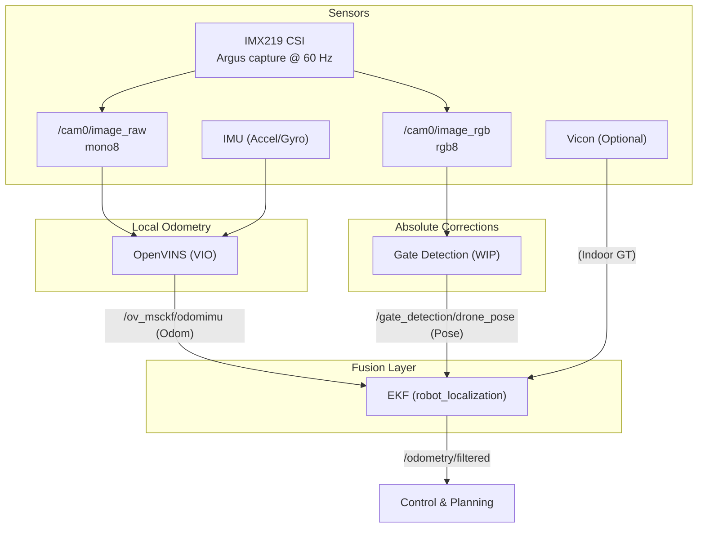

# Perception Stack Overview

**Page Owner:** [Ilyas Seckin](https://github.com/ilysec)

---

The perception stack is responsible for providing a reliable, drift-free state estimate of the drone in the world frame. It achieves this by fusing high-frequency relative odometry with sparse absolute pose corrections.

## High-Level Architecture

The system follows a tiered architecture for pose estimation:



## Topic Mappings

The following table summarizes the data flow between perception modules.

| Source Module | Topic Name | Message Type | Frequency | Consumer |
| :--- | :--- | :--- | :--- | :--- |
| **Camera** | `/cam0/image_raw` | `sensor_msgs/Image` (`mono8`) | 60 Hz | VIO / mono debug |
| **Camera** | `/cam0/image_rgb` | `sensor_msgs/Image` (`rgb8`) | 60 Hz target | Gate Detection / color debug |
| **Video Encoder** | `/cam0/image_h264` | `sensor_msgs/CompressedImage` | 60 Hz target | Recording / ground station decoder |
| **Sensors** | `/imu0` | `sensor_msgs/Imu` | 200 Hz | VIO |
| **OpenVINS** | `/ov_msckf/odomimu` | `nav_msgs/Odometry` | 100 Hz | EKF |
| **Gate Detection** | `/gate_detection/drone_pose` | `PoseWithCovarianceStamped` | 10-30 Hz | EKF |
| **Vicon** | `/vicon/drone/drone` | `geometry_msgs/Transform` | 100 Hz | EKF |
| **EKF** | `/odometry/filtered` | `nav_msgs/Odometry` | 100 Hz | Control |

## Coordinate Systems

The perception stack utilizes the standard ROS 2 (REP-103) coordinate conventions:

- **`world` Frame**: Global fixed frame. Its origin is typically defined at the start of the mission.
- **`odom` Frame**: A locally stable frame provided by the EKF. It is continuous (no jumps) but may drift relative to the `world` frame over long durations if absolute fixes are lost.
- **`base_link` Frame**: The center of mass of the drone.
    - **X-axis**: Forward
    - **Y-axis**: Left
    - **Z-axis**: Up

## Detailed Workings

### 1. Visual-Inertial Odometry (OpenVINS)
The **VIO** component uses the `open_vins` library to fuse camera images and IMU data.
- **Formulation**: Implements an **Extended Kalman Filter (EKF)** with a **Multi-State Constraint Kalman Filter (MSCKF)**.
- **Constraint-Based**: It avoids estimating feature positions in the main filter state, making it highly efficient for high-speed flight.
- **Online Calibration**: Online-calibrates the rotation and translation between the Camera and IMU.
- **Output**: Published as `nav_msgs/Odometry` on `/ov_msckf/odomimu`.

### 2. Gate Detection & PnP (WIP)
The **Gate Detection** component identifies racing gates and estimates the drone's pose relative to them.
- **Deep Learning**: Uses a **U-Net** based segmentation network (**GateNet**) to detect gate masks.
- **QuAdGate**: Extracts sub-pixel corner candidates and matches them using geometric descriptors.
- **PnP Solver**: Uses `cv2.solvePnP` to find the absolute translation and rotation from the known gate dimensions to the observed pixel coordinates.
- **Output**: Published as `geometry_msgs/PoseWithCovarianceStamped` on `/gate_detection/drone_pose`.


### 3. Fusion Logic (The EKF)
The system uses `robot_localization` with **Smooth Lagged Data** support.
- **Rewind/Fast-Forward**: Vision processing takes time (50-100ms). The EKF maintains a history of past states, "rewinds" to the image timestamp to fuse the delayed measurement, and then re-propagates the state to the current time.
- **Output**: The definitive state estimate on `/odometry/filtered`.

## Modules

For deeper technical details on individual components, see:
- [Jetson Camera Pipeline](camera_pipeline.md)
- [VIO (OpenVINS)](vio.md)
- [Blackbox Driver (IMU/RPM)](blackbox.md)
- [Gate Detection](gate_detection.md)
- [Sensor Fusion (EKF)](EKF.md)
- [Vicon Tracking](vicon.md)

## Visualization and Monitoring

Visualizing the internal state of the drone is crucial for debugging perception and control algorithms.

### RViz Visualization
We use RViz2 to visualize sensor data, gate detections, and EKF state. Most perception launch files include an `rviz:=true` argument to automatically open a pre-configured RViz window.

### Full Perception Launch
You can launch the integrated perception stack (VIO + Gate Detection + EKF) in simulation or on the hardware using:
```bash
source install/setup.bash
ros2 launch launch/perception.launch.py
```

## Jetson Bringup

On the drone, perception owns the CSI camera by default:

```bash
ros2 launch drone_control racing_bringup.launch.py \
  msp_bench_mode:=true \
  publish_raw:=true \
  view_stream:=false
```

This starts the IMX219 camera at `1280x720 @ 60 Hz` and publishes
`/cam0/image_raw` for OpenVINS and `/cam0/image_rgb` for color consumers. Gate
detection is currently disabled by default in racing bringup because the package
is still WIP.

H.264 streaming is no longer an exclusive camera mode. When
`view_stream:=true h264_backend:=gstreamer_ros`, the camera node publishes
hardware-encoded `/cam0/image_h264` while the mono and RGB topics stay live. See
[Jetson Camera Pipeline](camera_pipeline.md) and
[H.264 Video Streaming](../groundstation/video-streaming.md).
