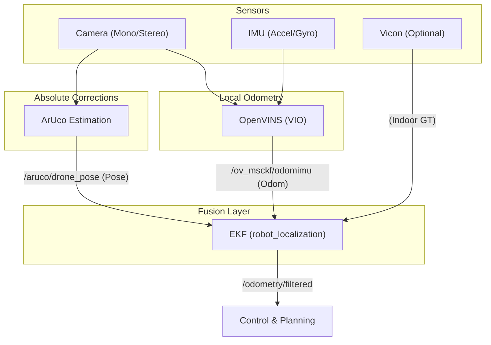

# Perception Stack Overview

The perception stack is responsible for providing a reliable, drift-free state estimate of the drone in the world frame. It achieves this by fusing high-frequency relative odometry with sparse absolute pose corrections.

## High-Level Architecture

The system follows a tiered architecture for pose estimation:

## Topic Mappings

The following table summarizes the data flow between perception modules.

| Source Module | Topic Name | Message Type | Frequency | Consumer |
| :--- | :--- | :--- | :--- | :--- |
| **Sensors** | `/cam0/image_raw` | `sensor_msgs/Image` | 30 Hz | VIO, ArUco |
| **Sensors** | `/imu0` | `sensor_msgs/Imu` | 200 Hz | VIO |
| **OpenVINS** | `/ov_msckf/odomimu` | `nav_msgs/Odometry` | 100 Hz | EKF |
| **ArUco** | `/aruco/drone_pose` | `PoseWithCovarianceStamped` | 30 Hz | EKF |
| **Vicon** | `/vicon/drone/drone` | `geometry_msgs/Transform` | 100 Hz | EKF |
| **EKF** | `/odometry/filtered` | `nav_msgs/Odometry` | 100 Hz | Control |

## Coordinate Systems

The perception stack utilizes the standard ROS 2 (REP-103) coordinate conventions:

- **`world` Frame**: Global fixed frame. Its origin is typically defined at the start of the mission or at the location of a primary ArUco marker.
- **`odom` Frame**: A locally stable frame provided by the EKF. It is continuous (no jumps) but may drift relative to the `world` frame over long durations if absolute fixes are lost.
- **`base_link` Frame**: The center of mass of the drone.
    - **X-axis**: Forward
    - **Y-axis**: Left
    - **Z-axis**: Up

## Detailed Workings

### 1. Visual-Inertial Odometry (OpenVINS)
The **VIO** component uses the `open_vins` library to fuse camera images and IMU data.
- **Formulation**: Implements an **Extended Kalman Filter (EKF)** with a **Multi-State Constraint Kalman Filter (MSCKF)**.
- **Constraint-Based**: It avoids estimating feature positions in the main filter state, making it highly efficient for high-speed flight.
- **Online Calibration**: Online-calibrates the rotation and translation between the Camera and IMU.
- **Output**: Published as `nav_msgs/Odometry` on `/ov_msckf/odomimu`.

### 2. ArUco Selection & Gating
The **ArUco** component detects physically placed markers to eliminate VIO drift.
- **Corner Tracking**: Uses **Lucas-Kanade optical flow** to track corners between vision frames, maintaining pose locks during high-speed maneuvers or motion blur.
- **Mahalanobis Gating**: The EKF performs statistical checks on incoming ArUco detections. Discordant measurements (e.g., poor quality detections from long range) are automatically rejected.
- **Output**: Published as `geometry_msgs/PoseWithCovarianceStamped` on `/aruco/drone_pose`.

### 3. Fusion Logic (The EKF)
The system uses `robot_localization` with **Smooth Lagged Data** support.
- **Rewind/Fast-Forward**: Vision processing takes time (50-100ms). The EKF maintains a history of past states, "rewinds" to the image timestamp to fuse the delayed measurement, and then re-propagates the state to the current time.
- **Output**: The definitive state estimate on `/odometry/filtered`.

## Modules

For deeper technical details on individual components, see:
- [VIO (OpenVINS)](vio.md)
- [ArUco Detection](ArUco.md)
- [Sensor Fusion (EKF)](EKF.md)
- [Vicon Tracking](vicon.md)
