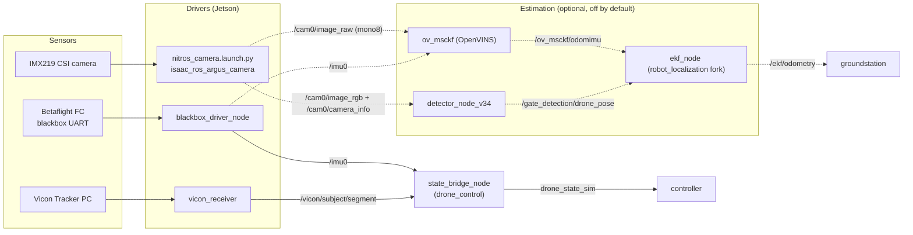

# Perception overview — technical

**Owner:** [Ilyas Seckin](https://github.com/ilysec)

What the perception stack is made of, how data flows between the pieces, and which conventions (frames, timestamps, QoS) every piece must respect.

## Data flow

Solid arrows run on every flight. Dashed arrows exist only when the corresponding `racing_bringup.launch.py` flag (`use_vio`, `use_gate_detection`, `use_ekf`) is set.

## What is in the flight loop

The controller does **not** consume the EKF. `racing_bringup.launch.py` always starts `state_bridge_node` (`src/drone_control/drone_control/state_bridge_node.py`), which subscribes to the Vicon pose and `/imu0`, differentiates position for velocity, and publishes the controller's state vector on `drone_state_sim`. VIO, EKF and gate detection are gated behind `use_vio`, `use_ekf`, `use_gate_detection`, all `false` by default. The only subscriber of `/ekf/odometry` in the repository is the groundstation.

Consequences for anyone working on estimation:

- A change to the EKF, VIO or gate detector cannot break a flight unless someone passes the corresponding flag.
- Conversely, none of them has been validated in closed loop on hardware. The replay tooling (`launch/perception_replay*.launch.py`) is the only place the EKF has been run against real data.

## Topic contract

Hardware topics as produced by `racing_bringup.launch.py` on the Jetson. Rates are nominal; QoS is listed on each subsystem's technical page where it was read from the code.

| Topic | Type | Producer | Rate | Consumers |
| :--- | :--- | :--- | :--- | :--- |
| `/cam0/image_raw` | `sensor_msgs/Image`, `mono8` | `format_converter_mono` (NITROS) | 60 Hz | OpenVINS, calibration bags |
| `/cam0/image_rgb` | `sensor_msgs/Image`, `rgb8` | `rgb_flip` (NITROS) | 60 Hz | gate detection, debugging |
| `/cam0/image_raw_nitros` | NITROS image | `argus_mono` | 60 Hz | encoder, format converters |
| `/cam0/camera_info` | `sensor_msgs/CameraInfo` | `argus_mono`, from `camera_info_url` | 60 Hz | gate detection |
| `/cam0/image_h264` | `sensor_msgs/CompressedImage` | Isaac ROS encoder (`h264_backend:=isaac_ros` only) | 60 Hz | ground station decoder |
| `/imu0` | `sensor_msgs/Imu`, frame `imu_link` | `blackbox_driver_node` | `target_hz` (150) | OpenVINS, `state_bridge_node` |
| `/motor_rpm` | `std_msgs/Float64MultiArray[4]` | `blackbox_driver_node` | blackbox frame rate (~2 kHz) | logging |
| `/battery` | `sensor_msgs/BatteryState` | `blackbox_driver_node` | every 40th frame (~50 Hz) | logging, low-voltage warning |
| `/vicon/<subject>/<segment>` | `geometry_msgs/PoseStamped`, frame `map` | `vicon_receiver` | Vicon frame rate | `state_bridge_node`, replay tools |
| `/ov_msckf/odomimu` | `nav_msgs/Odometry`, frames `global`→`imu` | `ov_msckf` | IMU rate | EKF `odom0` |
| `/gate_detection/drone_pose` | `geometry_msgs/PoseWithCovarianceStamped`, frame `world` | `detector_node_v34` | ≤ 30 Hz | EKF `pose0` |
| `/ekf/odometry` | `nav_msgs/Odometry`, frames `odom`→`base_link` | `ekf_filter_node` | 100 Hz | groundstation |
| `/accel/filtered` | `geometry_msgs/AccelWithCovarianceStamped` | `ekf_filter_node` | 100 Hz | — |
| `drone_state_sim` | `std_msgs/Float64MultiArray` | `state_bridge_node` | 100 Hz | controller |

`<subject>` and `<segment>` default to the Jetson hostname (`zephyrus`, `boreas`).

## Frames

There is no single world frame. Each producer names its own, and the consumer is responsible for the transform.

| Frame | Convention | Who uses it |
| :--- | :--- | :--- |
| `map` | Vicon volume origin, z up. `vicon_receiver` publishes poses here after applying the (identity) `map`→`vicon` static transform. | Vicon, `state_bridge_node` |
| `world` | ENU, z up. EKF `world_frame`/`map_frame`; gate detector output frame. | EKF, gate detection |
| `global` / `imu` | OpenVINS odometry `frame_id` / `child_frame_id`. Gravity-aligned at initialization, origin at first pose. | OpenVINS |
| `odom` → `base_link` | EKF output; `base_link` is FLU (x forward, y left, z up). | EKF, TF |
| `imu_link` | `frame_id` on `/imu0`. Axes are exactly what Betaflight reports; the driver does not remap them. | blackbox driver |
| `cam0` | Camera frame on images and `camera_info`. | camera, OpenVINS |
| Gate-local | Origin on the ground at the gate centre line, +x through the gate, +y left, +z up. | gate detection |
| Parkour map | **NED** (`config/parkour_map.yaml`). Gate positions are the AIGP course, not the lab. | gate detection |

Static transforms that must exist for the EKF to accept its inputs — none of them are published by `racing_bringup.launch.py`; only `launch/perception_replay.launch.py` publishes them:

- `world` → `global` (identity) so that `/ov_msckf/odomimu` can be transformed into the EKF world frame.
- `base_link` → `imu` so that OpenVINS twist (child frame `imu`) can be used.
- `world` → `map` (identity) if Vicon is to be fused or compared.

## Timestamps

| Source | Stamp | Note |
| :--- | :--- | :--- |
| `/imu0` (blackbox) | ROS wall clock at the publish timer | `use_blackbox_time_for_stamp:=true` switches to the flight controller's microsecond clock, offset to ROS time on first frame |
| `/vicon/...` | Node clock at receipt | No latency compensation in the pinned `vicon_receiver` |
| `/cam0/*` (NITROS) | Argus capture time via Isaac ROS | Not verified in this repository |
| `/cam0/*` (`imx219_argus_camera`) | ROS `now()` in the appsink callback | Not the GStreamer buffer PTS |
| AIGP camera / IMU | Receipt time / simulator clock | Two different clocks; see [AIGP → Technical](../aigp_drivers/technical.md) |
| `/gate_detection/drone_pose` | Copied from the input image | Lets the EKF fuse it at capture time |

The camera and IMU therefore share no hardware clock. The design for hardware synchronization is in [VIO synchronization](../../drone-setup/vio_synchronization.md); nothing in the drivers implements it yet.

## Launch ownership

| Launch file | Starts |
| :--- | :--- |
| `src/drone_control/launch/racing_bringup.launch.py` | Everything on the drone: camera (via `nitros_camera.launch.py`), IMU driver, Vicon receiver, `state_bridge_node`, controller; optionally VIO, EKF, gate detection, H.264 |
| `src/drone_control/launch/nitros_camera.launch.py` | Isaac ROS Argus camera + format converters (the production camera path) |
| `launch/perception.launch.py` | Camera + gate detection + VIO + EKF without the controller. Currently fails on two defaults, see [Overview → Workflow](workflow.md#perceptionlaunchpy) |
| `launch/perception_replay.launch.py` | VIO + EKF + static TFs against a recorded bag |
| `launch/perception_replay_vio_subst.launch.py` | EKF against a bag with Vicon substituted for VIO |
| `src/perception/<pkg>/launch/*` | Single-node launches, documented on each subsystem page |

## Simulation helpers

Two small packages draw Gazebo ground truth in RViz. Both subscribe to `/odometry` (`nav_msgs/Odometry`) and publish `visualization_msgs/Marker` with permanent lifetime and an ever-increasing id, so RViz memory grows for as long as they run.

| Package | Publishes | Notes |
| :--- | :--- | :--- |
| `gazebo_ground_thruth` | `/gazebo_ground_thruth` (blue sphere trail), `/gazebo_ground_thruth_arrow` (orientation), `/gazebo_ground_thruth_frame` (RGB axes) | Parameter `world_frame` (default `world`) |
| `pointcloud_gt` | `/PointCloud_GT` (sphere trail only) | Older duplicate of the above; not a point cloud despite the name |

Gazebo sensor topics reach ROS through `src/utils/gazebo_ros_bridges` (configured per world). The SITL setup is documented under [SITL Simulation](../../getting-started/sitl_simulation.md).

## Repository layout

| Path | Contents |
| :--- | :--- |
| `src/perception/imx219_argus_camera/` | GStreamer camera node (calibration recording; Jetson only) |
| `src/perception/betaflight_blackbox_driver/` | Blackbox UART decoder and MSP IMU poller |
| `src/perception/VIO/open_vins/` | OpenVINS fork (submodule `ETHRoboticsClub/open_vins_RETH`) |
| `src/perception/ekf/ekf/` | EKF configs, launch files, mock publisher, tests |
| `src/perception/ekf/robot_localization/` | robot_localization fork with the 16-state quaternion filter (submodule `oliomap/robot_localization_drone`) |
| `src/perception/gate_detection/` | Gate detector (three generations, see its page) |
| `src/perception/aigp_camera_driver/`, `aigp_imu_driver/` | AI Grand Prix simulator adapters |
| `src/perception/camera_calibration/` | IMX219 intrinsics results and the printable checkerboard |
| `src/perception/gazebo_ground_thruth/`, `pointcloud_gt/` | RViz ground-truth markers |
| `src/perception/archive/ArUco_estimation/` | Deprecated, `COLCON_IGNORE` |
| `src/ros2-vicon-receiver/` | Vicon DataStream client (submodule) |
| `launch/perception*.launch.py` | Stack-level and replay launches |
| `scripts/calibration/`, `scripts/perception/` | Calibration, blackbox and replay helpers |
| `calibration/targets/` | Kalibr AprilGrid targets |

## Known issues (repository state, September 2026)

- `.gitmodules` lists `src/msp` and `src/h264_image_transport`, but their submodule entries were dropped in the mono-repo merge. `docker/Dockerfile` still copies and builds them, and `betaflight_blackbox_driver` depends on `msp`. A fresh clone does not build the perception Docker stage until this is restored.
- `launch/perception.launch.py` and `ekf/launch/rl_ekf.launch.xml` do not start with default arguments (missing `pose1`, missing gate-detection checkpoint). Details on the EKF and gate-detection pages.
