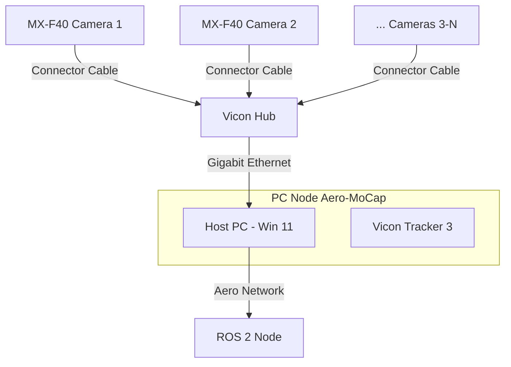

# Vicon Motion Capture

**Page Owner:** [Jules Schmutz](https://github.com/juliomathis)
---

## Overview

The Vicon system provides accurate 6-DOF pose estimates (position and orientation) by tracking retroreflective markers attached to the drone using an array of infrared cameras. It is used as ground truth localization for indoor flights.

The `ros2-vicon-receiver` package connects to the Vicon DataStream SDK server running on the Vicon PC, retrieves tracking data at the camera frame rate, and publishes it as ROS 2 topics.

## Setup

We are using a VICON system with at least 5 MX-F40 cameras, which should be able to cover a cylinder with a diameter of 6m and roughly 5m height. To cover the full testing arena (8x8x5m), at least 7 cameras are recommended.
This page describe the setup on a surface level, further details can be found in the [Prophysics AG user manual](https://www.prophysics.ch/wp-content/uploads/2017/06/Vicon-Tracker-User-Guide.pdf)

### Required Items
- **Cameras:** At least 5x MX-F40 cameras with mounting options (e.g., tripods).
- **Vicon Hub:** Central connection unit.
- **Cables:** Dedicated cables to connect cameras to the hub.
- **Host PC:** Windows 11 PC with **VICON Tracker 3** installed *(Tracker 4 is not compatible)*.
- **Ethernet Cable:** To connect the hub to the host PC.

> [!CAUTION]
> Before connecting everything, **power off the hub** and ensure cameras are mounted securely. 
> Due to component age, repairs are difficult, posing an operational risk. Take extreme caution!

### Installation Steps

1. **Positioning:** Place cameras in a circular pattern, pointing towards the center. Secure cables with strain relief.
2. **Routing:** Route cables to the Vicon Hub cleanly, avoiding sharp bends or tension.
3. **Connection:** Connect cables to the hub securely.
4. **Power On:** Turn on the hub via the silver metallic button on the front.
5. **Software:** Launch **Tracker 3**. Cameras should be recognized within a minute.
6. **Verification:** 
   - LEDs on cameras should light up **green**.
   - Select all cameras in Tracker 3 and open the **Camera Preview** tab to see live infrared view.
   - *If this fails, power off immediately and reach out to your lead.*

### System Connection Layout



## Calibration

Before utilising the VICON system, it must be calibrated to ensure accurate position estimation. The process is divided into three main phases in the **Vicon Tracker 3** software.

### 1. Camera Masking
Eliminate noise from static reflections or sunlight.
- Go to the **Calibrate** tab.
- Click **Auto Mask** to automatically ignore static points of light or reflections in the cameras' view.
- Ensure the calibration volume is clear of moving reflective materials during this.

### 2. Camera Calibration (The Wand Wave)
Calculate the physical coordinates, rotation, and lens properties of each camera.
- In the **Calibrate Cameras** section, select your dynamic calibration object (**Wand**) from the dropdown.
- Click **Start** to begin data capture.
- **Wave the Wand** slowly throughout the entire intended capture volume, ensuring markers are visible to multiple cameras. Make sure to go into depth too.
- The software will automatically complete this phase once sufficient coverage and tracking quality thresholds are met. If the errors are too high or if some cameras are missing, redo the calibration.

### 3. Setting the Volume Origin (The L-Frame)
Define the center (0,0,0) and rotational alignment (X, Y, Z axes) of the absolute coordinate frame.
- Place the static calibration object (**T-Frame**) flat on the arena floor at the desired origin location.
- In the **Set Volume Origin** section, select the corresponding **T-Frame** model.
- Click **Start** to trace its static orientation.
- Click **Set Origin** to lock the global zero point alignment. 

> [!IMPORTANT]
> A successful origin set will align the grid in the 3D Perspective view with your real-world lab floor layout coordinates.


## Output Topics

For each tracked object (subject + segment pair defined in Vicon Tracker), the node automatically creates a publisher:

### Pose
- **Topic**: `/vicon/<SubjectName>/<SegmentName>`
- **Type**: `geometry_msgs/msg/PoseStamped`
- **Description**: 6-DOF pose of the tracked object expressed in the world (`map`) frame. Position is in meters; orientation is a quaternion.
- **Example**: `/vicon/drone/drone`

### Transforms (TF)
- **`/tf`** — Dynamic transform from the `vicon` frame to each `<SubjectName>_<SegmentName>` frame, broadcast every frame.
- **`/tf_static`** — Static transform from `map` to `vicon` origin, set at launch via `map_xyz` and `map_rpy` parameters.

## Launch

```bash
ros2 launch vicon_receiver client.launch.py \
  hostname:=192.168.0.29 \
  topic_namespace:=vicon \
  buffer_size:=200 \
  world_frame:=map \
  vicon_frame:=vicon \
  map_xyz:='[0.0, 0.0, 0.0]' \
  map_rpy:='[0.0, 0.0, 0.0]' \
  map_rpy_in_degrees:=false
```

### Parameters

| Parameter | Default | Description |
|---|---|---|
| `hostname` | `127.0.0.1` | IP address of the Vicon PC running the DataStream server |
| `buffer_size` | `200` | DataStream SDK internal buffer size |
| `world_frame` | `map` | Name of the world frame in TF |
| `vicon_frame` | `vicon` | Name of the Vicon origin frame in TF |
| `map_xyz` | `[0,0,0]` | Translation (meters) from `world_frame` to `vicon` origin |
| `map_rpy` | `[0,0,0]` | Rotation (rad or deg) from `world_frame` to `vicon` origin |
| `map_rpy_in_degrees` | `false` | Set to `true` if `map_rpy` values are in degrees |

## Setting Up a Tracked Object

In **Vicon Tracker** software on the Vicon PC:

1. Create a new object in Vicon Tracker, assign the markers, and give it a name (e.g. `drone`).
3. The segment name defaults to the same as the subject name.
4. The resulting ROS topic will be `/vicon/drone/drone`.
