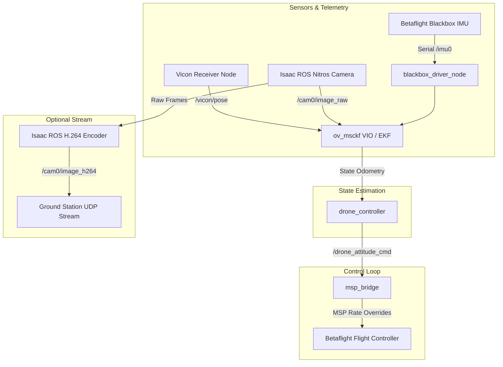

# ROS Racing Bringup Guide

**Page Owner:** [Leads of the Aeronautics Division](https://github.com/orgs/ETHRoboticsClub/teams/aeronautics/)

---

The `racing_bringup.launch.py` launchfile is the **primary entry point** for launching the full autonomous drone racing stack on physical hardware (e.g., the *Zephyrus* or *Boreas* drones). It orchestrates the initialization and configuration of all onboard sensors, drivers, localization pipelines, communication bridges, and flight controllers.

---

## 🏗️ Architecture & Component Flow

When launched, `racing_bringup.launch.py` links the entire pipeline together:



---

## 🖥️ Companion Computer & Machine Detection

The launchfile auto-detects its environment using the hostname:
* **Jetson Boards:** If running on hostname `zephyrus`, `boreas`, or `jetson`, the stack defaults to using hardware-accelerated drivers (e.g., Isaac ROS camera pipeline and hardware H.264 encoding) and binds to the Jetson-specific UART ports.
* **General Hosts:** If running on other machines, it adjusts the serial ports and falls back to CPU-based pipelines.

---

## ⚙️ Launch Arguments & Options

### 1. Telemetry & IMU Configuration

| Argument | Default (Jetson / PC) | Description |
| :--- | :--- | :--- |
| `imu_port` | `/dev/ttyTHS1` / `/dev/ttyUSB0` | The serial UART port connected to the Betaflight Blackbox serial output. |
| `imu_source` | `blackbox` | Source of IMU/telemetry: `blackbox` (recommended, high-rate) or `msp` (slower, diagnostics). |
| `imu_baud` | `1500000` | Baudrate for the high-rate IMU serial stream. |
| `target_hz` | `150` | Target rate (Hz) for publishing standardized IMU messages (`/imu0`). |

### 2. Flight Controller & MSP Settings

| Argument | Default (Jetson / PC) | Description |
| :--- | :--- | :--- |
| `msp_port` | `/dev/ttyTCU0` / `/dev/ttyACM0` | The serial port connected to the FC for MSP commands. |
| `use_rc_sim` | `true` | Enable the `msp_bridge` node to inject rate overrides for autonomous flight. |
| `msp_bench_mode`| `false` | Set to `true` to disable `msp_bridge` when debugging with a standalone TX emulator. |
| `load_bf_config`| `false` | Auto-load standard Betaflight configurations (PID rates, receiver modes) to the FC on startup. |

### 3. Perception & Video Streaming

| Argument | Default | Description |
| :--- | :--- | :--- |
| `publish_raw` | `false` | Publish raw mono frames (`/cam0/image_raw`) for the VIO tracker. |
| `publish_rgb` | `true` | Publish standard color frame (`/cam0/image_rgb`) for Gate Detection. |
| `view_stream` | `true` | Enable H.264 compression and secondary UDP streaming to the ground station. |
| `h264_backend` | `isaac_ros` | Backend for encoding: `isaac_ros` (GPU accelerated), `gstreamer_ros`, or `gstreamer`. |
| `ground_station_ip` | `10.200.117.1` | The target IP of the ground station receiving the UDP H.264 stream. |
| `camera_info_url` | *(Project path to camera_info.yaml)* | Path to the camera calibration file. |

### 4. Localization & Fusion

| Argument | Default | Description |
| :--- | :--- | :--- |
| `use_vio` | `true` | Start the visual-inertial odometry estimator (`ov_msckf`). |
| `use_vicon` | `true` | Start the Vicon receiver client to ingest millimeter-accurate ground truth. |
| `use_gate_detection`| `false` | Enable gate detector node (requires `gate_detection` package to be built). |

### 5. Controller Configuration

| Argument | Default | Description |
| :--- | :--- | :--- |
| `controller_type` | `rl` | Controller to run: `mpc` (Model Predictive Control) or `rl` (Reinforcement Learning policy). |
| `rate_error_scale`| `300.0` | Tuning scale factor for RL torque commands. |

---

## 🚀 Common Launch Recipes

### A. Full Autonomous Flight Mode (Recommended)
This recipe launches the full hardware stack, loading the VIO estimator, checking Vicon ground truth, enabling the low-latency IMU telemetry, and running the default controller:
```bash
ros2 launch drone_control racing_bringup.launch.py \
  use_vio:=true \
  use_vicon:=true \
  controller_type:=mpc
```

### B. Bench / Hardware Testing Mode
Use this mode when testing on the bench without props. Disables localization and automatically uploads the safety-limited bench configuration to Betaflight:
```bash
ros2 launch drone_control racing_bringup.launch.py \
  use_vio:=false \
  use_vicon:=false \
  load_bf_config:=true \
  msp_bench_mode:=true
```

### C. RL Inference Mode with Camera Streaming
Launches the RL controller and starts Isaac ROS H.264 streaming to the ground station for visual validation:
```bash
ros2 launch drone_control racing_bringup.launch.py \
  controller_type:=rl \
  view_stream:=true \
  h264_backend:=isaac_ros
```

---

## 🔗 Related Documentation

* [**AIGP Racing Bringup**](aigp_bringup.md) — How to bring up the simulation-equivalent stack for virtual qualifications.
* [**Fly the Drone Guide**](controls/flying_the_drone.md) — Pre-flight checklists, arming procedures, and safety considerations.
* [**Betaflight Configuration**](betaflight.md) — Telemetry protocols, MSP ports, and manual receiver overrides.
* [**Vicon**](perception/vicon/workflow.md) — Setting up the Vicon motion capture bridge.
* [**VIO**](perception/vio/workflow.md) — Tuning the `ov_msckf` estimator.
* [**Troubleshooting**](controls/troubleshooting.md) — Common serial errors, daemon hangs, and latency issues.
