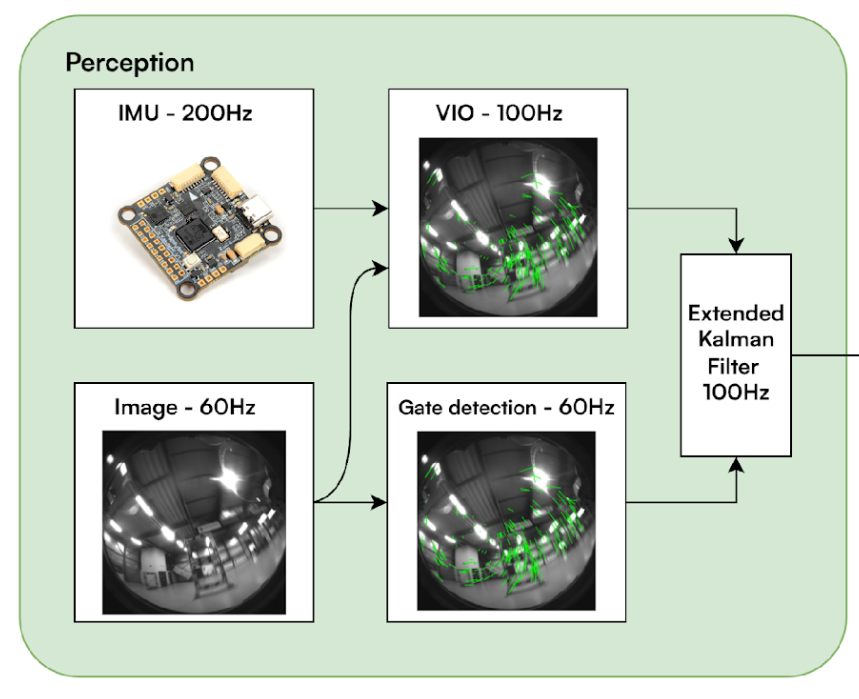

# Perception 
Perception stack of the autonomous drone racing project at RETH

## Overview



### High-Level Pipeline

The perception pipeline consists of the following main components:

1. **VIO (Visual-Inertial Odometry)**: The OpenVINS system processes camera images and IMU data to provide a continuous pose estimate:
   - **Feature Tracking**: Extracts and tracks visual features across consecutive frames
   - **State Estimation**: Uses an Extended Kalman Filter (EKF) with Multi-State Constraint Kalman Filter (MSCKF) formulation to fuse visual and inertial measurements
   - **Pose Output**: Provides the drone's 6-DOF pose (position and orientation) with covariance estimates

2. **Gate Detection**: Detects and localizes racing gates in the camera images:
   - Processes camera frames to identify gate structures
   - Estimates gate pose relative to the camera
   - Provides gate detection measurements with associated uncertainties

3. **EKF Fusion**: An Extended Kalman Filter fuses both VIO and gate detection estimates:
   - Combines the continuous VIO pose estimates with discrete gate detection measurements
   - Improves accuracy by leveraging gate detections as absolute position references
   - Outputs the final fused pose estimate for use by control and planning modules


## Building the package 

Go into the root of the workspace and execute the following command:

```
colcon build --symlink-install --cmake-args -DCMAKE_BUILD_TYPE=Release 
```

The cmake **Release** option is foundamental for having the best possible computational performance

### Source 
```
source install/setup.bash
```

## Running the pipeline

Start the px4 submodule. Inside the docker container run:

```
cd px4/PX4-Autopilot/
make clean
make px4_sitl gz_x500_cam
```

Open a new terminal and go into the docker container. From the root (`ros_ws`) run:

```
ros2 launch launch/perception.launch.py
```

This starts Vision, VIO, EKF and the camera bridge.


